# Native editor UI specification

Owner-approved reference: **Microsoft Word 2024 desktop for Windows**, classic
expanded multi-row ribbon, English UI and light theme. Rust is mandatory; the
library does not determine the product layout. This specification is an initial
measurable implementation baseline, not a claim of pixel equivalence.

## Reference evidence and limits

Checked 2026-10-17. [Microsoft navigation documentation](https://support.microsoft.com/en-us/accessibility/word/use-a-screen-reader-to-explore-and-navigate-word)
identifies title/quick actions, ribbon, document, status, navigation and File areas.
[Microsoft keyboard documentation](https://support.microsoft.com/en-us/accessibility/word/keyboard-shortcuts-in-word)
supplies the familiar file/edit/alignment, command-search and ribbon-collapse keys.
Both apply to Word 2024 and other versions; they are not a frozen screenshot of a
particular retail build. The [publisher's Word 2024 sample, pp. 5–11](https://store.ccilearning.com/wp-content/uploads/2026/01/3290-Microsoft-2024-Word-Associate-Book-Sample.pdf)
corroborates the ordered Home/Insert/Draw/Design/Layout/References/Mailings/Review/
View/Help tabs and Home grouping. Its PDF text was accessible, but the screenshot
endpoint failed. Draw visibility and contextual tabs depend on settings/content.

The official [Word 2024 theme announcement](https://support.microsoft.com/en-gb/word/what-s-new-in-word-2024-for-windows-and-mac) and its [theme image](https://support.microsoft.com/en-gb/word/media/office-theme.png) were also inspected in a browser. The Word portion shows a light, rounded ribbon surface, compact icon rows, understated tab selection and a style gallery. This is a publisher image without controlled window/DPI/build metadata, so it informs composition only. No external artwork is included in the application.

A running Windows/Word 2024 reference is unavailable on this macOS host. Therefore
**no matched screenshot comparison, measured Word pixel deltas, visual fidelity
percentage or native Windows 100%/125%/150% pass is reported**. Exact reference build,
font metrics, spacing and order under a named Windows configuration remain an R1 gate.

## Implemented geometry

Values below are Docs design values in device-independent points (DIP), **not
measurements taken from Word**. Source constants are in `src/presentation.rs`; original vector controls are in `src/chrome.rs`.

| Area | Docs value / observable behavior |
| :--- | :--- |
| Default window / minimum | 1366 × 900 / 640 × 480 DIP; native custom title controls |
| Title | 44 DIP high; 24 × 24 approved transparent icon, 28 × 28 Save/Undo/Redo icons; actual filename and dirty marker; 28-DIP search field; 46-DIP-wide vector window controls |
| Tabs | 32 DIP; File, Home, Insert, Draw, Design, Layout, References, Mailings, Review, View, Help; narrow windows use More tabs |
| Ribbon | 104 DIP expanded; near-white rounded inset (8 DIP horizontally / 4 vertically), 88-DIP groups with bottom captions; collapsible via button, double-click tab or Ctrl+F1 |
| Home groups, full | Clipboard 86, Font 304, Paragraph 246, Styles 350, Editing 116 DIP; 8-DIP group gaps and separators |
| Home groups, compact | Below 1180 DIP available ribbon width: 82/246/218/140/104 DIP; compact Clipboard and one style preview |
| Home overflow | Below 900 DIP available ribbon width: 82/232/206 DIP; Styles/Editing move into More menu; the pinned ribbon reserves workspace; temporary mode overlays it |
| Controls | Small buttons 24–32 × 24–26 DIP; Paste 46 × 69 split into a 37-DIP icon action and 32-DIP options menu; two rows in Font/Paragraph, three in Clipboard/Editing; 13-DIP UI text, 11-DIP captions; 15 × 16 group launchers |
| Font size | 64 × 25 DIP unified outline: 46-DIP editable field and 18-DIP preset arrow; font-family field is 112/64/50 DIP in full/compact/overflow density |
| Workspace | Neutral #ebebeb; white continuous canvas, border #c5c5c5; soft canvas shadow; 10-DIP workspace top gap; centered when space allows; horizontal/vertical scrolling when required |
| Canvas | 816 DIP wide at 100% document zoom, 96-DIP side/top margins, content-driven height; **no page segmentation** |
| Text | Host Arial/DejaVu or embedded fallback; default 11 pt (14.667 DIP), per-run 1–400 pt in half-points and underline; 1.25 line height, default-size 0.5-em paragraph gap; model styles/alignment projected into hit-testable text |
| Ruler | 22-DIP-high horizontal canvas ruler with shaded margins, 96 DIP per inch, eighth-inch ticks; zoom scales with document; no draggable margins or vertical/page ruler yet |
| Panes | Navigation left 240 DIP (195–320); Formatting right 220 DIP (195–300); visible on request |
| Status | 24 DIP; real Unicode word count and paragraph count, saved state, continuous-layout label and 50–200% zoom; ±10% buttons and click percentage to reset to 100% |
| File | 180-DIP left action rail and scrollable Home/Options body; 158 × 160 blank-document tile, real current-file properties; New/Open/Save/Save As active, Print disabled with explanation |

## Commands and interaction

Active Home commands are plain-text clipboard, bold/italic/underline, font size,
Grow/Shrink Font, Clear character formatting, four alignments, Find, Replace selected/next match, previewed Replace All and Select All. Emphasis controls show selected state and set
pending insertion style at an empty selection. Original vector strokes draw clipboard, file, history, search, paragraph, window and
launcher controls. Button names are exposed to the toolkit accessibility tree.
Selected formatting has a pale violet fill even without hover; focus uses an outline.
Font-family selection remains read-only with an explanation. Font size is editable:
1–400 pt in half-point steps, an empty field for mixed selections, and common presets
in a scrollable menu. Enter or leaving the field applies one shared command; Escape
cancels. Tab preserves traversal to the next control; Enter returns to the document.
Invalid input produces a visible error without changing model/history. Keyboard Save
commits pending size input before writing. Size and underline are disabled during
document IME composition. At a caret they set the next insertion style only.
Grow/Shrink Font steps each run independently through common presets (8–72 pt);
outside that interval it moves one point, bounded to 1–400 pt. Mixed selections
retain differing sizes; one click is one undo operation. Ctrl/Command+Shift+>/<
(period/comma) invokes the same command while the document has focus. Composition
disables these commands. The Paste icon performs plain-text paste; its lower menu
contains the same action and an explained disabled Paste Special. Find opens
navigation directly; its separate 18-DIP arrow opens options. Select opens a real
command menu; overflow retains Find/Replace/Select All/Formatting.
The 63-DIP Styles gallery applies Normal/No Spacing/Heading 1 through shared
commands. Its selected frame follows the uniform paragraph style; mixed selection
has no selected frame. A 15-DIP trailing menu exposes all styles at compact width.
See the alpha.18 behavior and inheritance rules below.
Native egui hover/pressed/disabled/focus states remain active; unsupported controls
have tooltips explaining the missing capability. Styling uses restrained violet
#7047ae, pale selected-state fill, light chrome and readable dark text.

The Font group launcher opens a modal with a 420-DIP content width: Font, Font style
and Size columns (172/136/92 DIP), preset list, mixed-state Underline checkbox,
54-DIP-high clipped preview and 82 × 27 DIP OK/Cancel buttons. These are Docs design
values, not measured reference values. Style choices set bold/italic together;
untouched properties retain mixed values. Size is initially focused and selected.
Enter/OK applies one command; Escape/Cancel discards all draft changes. Invalid size
stays visible in the dialog. Background document commands and window close are
blocked until the draft is resolved. Font-family choice is explained and disabled.
The Paragraph launcher retains the formatting pane. The official keyboard source
above confirms the Windows Font dialog shortcuts; its complete dialog and effects
are not claimed as implemented.

Other tabs expose disabled, explained controls. View has real rulers, navigation
and zoom; Help shows version and shortcuts. Object-specific contextual tabs are
planned when their document objects exist; none is shown for imaginary objects.
No application account, cloud connection or copied product branding is present.

Text input uses the actual native toolkit text widget with a model-derived rich
galley; it is not a painted string over a hidden document. Committed input and IME
commit call the same Rust commands as tests. Preedit stays transient. The model
owns undo; one widget update batches committed text events into one transaction.
Explicit paste/deletion/formatting commands have separate history boundaries.
Left/Right and deletion honor extended grapheme boundaries. Tab traverses controls;
F6/Shift+F6 cycles the document, visible navigation/formatting panes, status and
ribbon; Alt+Q searches real commands. Standard
Ctrl/Command N/O/S/Shift+S, B/I/U, Shift+P (focus/select size), Z/Y/Shift+Z, F/H and
L/E/R/J are implemented. Ctrl/Command+D or Shift+F opens the Font dialog.
Home/File KeyTips and Alt entry, plus quick-access/tab/View extensions, are described below. Contextual KeyTips,
native assistive technology and multilingual OS IME remain unverified/incomplete.

## Alpha.17 clear character formatting

Historical checkpoint: alpha.18 replaces the fixed 11-pt reset with inherited
paragraph values and advances native content to v3; see the alpha.18 section.

The existing original eraser icon is active as **Clear character formatting**.
Its 25 × 25 DIP control stays in the upper Font row. Full density retains Change
case before it; compact/overflow density uses the disabled Change case position
for the working eraser, keeping the existing Font widths and 8-DIP group gaps.
Artwork, semantic icon colors, violet selected states and neutral surfaces are
unchanged. The tooltip explains all four supported reset properties and the
preserved paragraph alignment; the accessible name matches the actual scope.

One command resets selected bold/italic/underline/size to regular 11 pt. At a
caret it resets pending input only. Undo/redo preserves exact prior/result styles,
selection and typing state; no-op content adds no history. Native v2 is unchanged.
Tab includes the newly active control; Home KeyTips H → FC and command search
invoke it at every ribbon density. FC is a Docs-specific mapping pending the
named Windows reference review; the existing E overflow mapping remains intact.

[Microsoft's text-formatting instructions](https://support.microsoft.com/en-us/powerpoint/clear-all-text-formatting)
place the eraser in Home/Font. Its [keyboard reference](https://support.microsoft.com/en-us/accessibility/word/keyboard-shortcuts-in-word)
identifies Ctrl+Space for manual character-format reset (checked 2026-10-17).
Docs intentionally exposes its narrower implemented scope: no named-style or
paragraph reset and no implicit word expansion at a caret. The physical Control
chord only runs in the document, excluding AltGr/Shift/Command, repeat and IME
lifecycle events. System shortcuts can intercept it; ribbon/KeyTips/search remain
available. No exact native shortcut/Word visual equivalence is claimed.

### Alpha.17 native captures

English/light theme, 100% zoom, macOS backing scale 2. The capture harness uses
`examples/Formatting.bfdoc` and real KeyTips events:

- [Clear applied, 1366 × 900 DIP](screenshots/rust-clear-formatting-alpha17-macos.png).
- [Font KeyTips before clear, 640 × 480 DIP](screenshots/rust-clear-formatting-alpha17-macos-narrow.png).

Windows 100/125/150%, native OS IME/accessibility and matched Word captures remain
unverified. Synthetic containment tests are distinct from those acceptance gates.

## Alpha.16 Replace All preview

Home Replace adds a real Replace All… button below the single-match action. It
prepares the same case/whole-word results without changing the document. The modal
shows exact match/change counts, find/replacement summaries, current options,
original paragraph/context and replacement excerpts. Excerpts are bounded and
marked with ellipses; the full text is used when applying. Empty replacement is
explicitly labelled as deletion, and equal-text matches are labelled unchanged.

| Component | Implemented dimensions / behavior |
| :--- | :--- |
| Preview | Content width up to 560 DIP, bounded to viewport width minus 48 DIP |
| Result list | Virtual 66-DIP rows; height 40–260 DIP according to viewport height, all matches accessible |
| Cancel | 80 × 27 DIP, initially focused; Enter here cancels without edits |
| Apply | At least 128 × 27 DIP; label contains actual change count; disabled for no-op plans |
| Keyboard/lifecycle | Tab/Enter activates the focused button; Escape cancels; background commands and native close wait until preview is resolved |
| Styling | Existing neutral surfaces, body font and violet accent; alpha.13 palette/icons and Home gutters retained |

Inserted text uses each match's first character formatting. Unaffected runs keep
their styles; unchanged text retains mixed formatting. One Undo restores all
changes and the prior selection; one Redo restores the complete result. A stale
preview or invalid/oversized result cannot partially edit the live document.
[ADR 0005](adr/0005-replace-all-preview.md) specifies paragraph/caret semantics.
This confirmation preview is a deliberate data-safety design, not a claim of
pixel-identical Word dialog behavior.

### Alpha.16 native captures

English/light theme, 100% document zoom, macOS backing scale 2:

- [Replace All, 1366 × 900 DIP](screenshots/rust-replace-all-alpha16-macos.png).
- [Replace All, 640 × 480 DIP](screenshots/rust-replace-all-alpha16-macos-narrow.png).

The harness constructs an original three-paragraph fixture through the shared
engine and opens preview through real widget keyboard events. All three matches
and their actual paragraph numbers are shown; no replacement has been applied.
The row allocation was corrected to the virtual list's declared height. Windows
100/125/150%, native OS IME/full accessibility and matched Word Windows captures
remain unverified; no similarity score is assigned.

## Alpha.15 search options

Preserve the alpha.13 palette/icons and existing Home dimensions. Add two real
checkboxes below the 26-DIP search field, inside the 260-DIP Navigation pane
(220–320 DIP resizable). The row wraps within the pane's available width rather
than extending over the document. Match case starts on; Whole words starts off.
Tab traverses Clear, Match case, Whole words and the result arrows; Space toggles
the focused option. Escape from either option returns focus to the document.
Options survive clearing/reopening the pane in the same window, but are not saved
across launches. Disabled states protect active input composition.

Changing a query/option selects the first valid result without an edit/history
operation. The counter, excerpts, document highlight and single-match replacement use the
same prepared query. Replacement remains one shared command and one undo operation.
Whole words requires a Unicode word start and end; apostrophes inside words are
retained, digits/underscores remain word constituents and phrases may span words.
A punctuation-only query has no whole-word results. Case-insensitive matching uses
Unicode simple folding, with original scalar positions; it does not normalize
accented text, expand ß to SS or apply Turkish/other locale-specific rules. Queries
above 4,096 UTF-8 bytes show an error with no truncation or replacement. Wildcards,
replace-all and broader linguistic search remain deferred.

### Alpha.15 native captures

English/light theme, 100% document zoom, macOS backing scale 2:

- [Search options, 1366 × 900 DIP](screenshots/rust-search-options-alpha15-macos.png).
- [Search options, 640 × 480 DIP](screenshots/rust-search-options-alpha15-macos-narrow.png).

The native harness enters lowercase `breakfree` and toggles both options with
Tab/Space, selecting the actual Welcome title. Inspection confirms contained
controls and retained palette/Home gutters. At minimum width the continuous
canvas scrolls horizontally; no pagination is claimed. The fixture's existing
emoji fallback limitation remains visible. Normal-binary keyboard verification
separately covers the options, replacement, history and Save/Open. Native Windows
100/125/150%, OS IME, complete accessibility and matched Word Windows screenshots
remain unverified; no similarity percentage is assigned. These inline options
are a scoped prototype convenience, not a claim to match Word's options dialog.

## Alpha.14 navigation results

The existing Home Find/Replace and View Navigation entry points now share the
same literal matcher. The Windows composition reference includes search results
and previous/next arrows ([Microsoft navigation documentation](https://support.microsoft.com/en-gb/word/use-the-navigation-pane-in-word?nochrome=true), inspected 2026-10-17; applies to Word 2024 Windows).
This source supports the workflow, not measured pixel equivalence or every shortcut.

| Component | Implemented measurement / behavior |
| :--- | :--- |
| Navigation pane | 260 DIP default, resizable 220–320 DIP; neutral `SURFACE`; consumes workspace width |
| Search field | 26 DIP height, adjacent Clear; focus retained during result traversal |
| Results header | Current result / total from model ranges; 24 × 24 DIP original vector chevrons |
| Result list | Virtual 64-DIP rows plus 3-DIP spacing, all matches available; real paragraph number and bounded context |
| Match cues | Bold excerpt text, existing violet selection; selected document range remains visible while search owns focus |
| Keyboard | Enter/Down next, Shift+Enter/Up previous while in search; wraps, Escape closes pane and restores document focus |
| Unsupported modes | Headings and Pages disabled with style/pagination explanations |

Exact case-sensitive, nonoverlapping matching rejects partial grapheme clusters;
no normalization, case folding, wildcard/whole-word options or replace-all. A
result selection changes no document/history; replacement uses the existing shared
command and the matched run's insertion style. Search updates after edits/undo.
Excerpts limit preceding/matched/following context to 18/32/24 graphemes, with an
ellipsis when shortened. Paragraph/tab separators use display-only separators;
source text is never rewritten. Long matches are selected in full in the document.

### Alpha.14 native captures

Captured on macOS, English/light theme, 100% document zoom, backing scale 2:

- [Navigation, 1366 × 900 DIP](screenshots/rust-navigation-alpha14-macos.png).
- [Navigation, 640 × 480 DIP](screenshots/rust-navigation-alpha14-macos-narrow.png).

The harness searches the actual Welcome fixture. Alpha.13 colors/icons and Home
gutters are retained. Native long-document input separately checks wrapped
navigation through 55 matches. Initial inspection caught missing font glyphs in
arrow labels and context: chevrons now use the existing vectors, excerpts the
same body-font families as the document. Remaining complex-script/font fallback
limits still apply. At 640 DIP the continuous canvas scrolls horizontally; it
is not repaginated. Native Windows 100/125/150%, a matched reference build and
full accessibility/IME remain unverified. No similarity score is assigned.

## Alpha.13 icon palette

On 2026-10-17 the owner supplied two local reference images showing a macOS
editing window and start screen in Russian. They support the requested color
roles: light neutral surfaces, dark glyphs, restrained blue details, a gold
clipboard, yellow highlighting and a red text-color indicator. They do not
identify the application's exact version/build or a Windows configuration.
Source images and desktop/file-list content are not included in this repository.
The approved Windows composition target remains; these are supplemental palette
references, not a controlled same-size/theme/language/zoom comparison.

| Role | Docs sRGB value / use |
| :--- | :--- |
| Window chrome | `#f3f4f5` title/tabs/status |
| Ribbon and File surface | `#fafafa`; white document/field interiors |
| Workspace / File rail | `#ebebeb` / `#ebedef`, replacing the tinted File rail |
| Text / boundaries | `#323130` / `#d5d5d5` |
| Hover / pressed | `#e7eaee` / `#dce0e5` |
| Brand focus / selection | `#7047ae` / `#e8e0f2` |
| Blue / pale blue | `#3a7db5` / `#e3eff9`: Save/New/Copy, scissors handles, arrows and text-effect glyph |
| Gold / pale gold | `#b0893e` / `#fff5d6`: Clipboard, Open and brush details |
| Yellow / red / eraser | `#f4d23e` / `#ca414c` / `#b771a7`: small highlight/color/eraser cues |

These are chosen Docs values, not sampled or certified reference colors. Original
Rust vector geometry uses dark outlines and small colored parts. Disabled icon
accents blend one part semantic color with two parts neutral `#e8e8e8`; labels
remain disabled gray. Unsupported highlighting, text color, effects and Format
Painter still do nothing and explain why. Their swatches are icon cues, not
claims about the current document's formatting. Hover, pressed, selected and
focus states retain the native button interaction. File Home, Options and Print
now share the same icon/text alignment as the existing file actions; Print stays
disabled. Home group widths, 8-DIP gaps, hit regions and overflow rules are unchanged.

### Alpha.13 native captures

Captured and visually inspected on macOS on 2026-10-17, English UI, light theme,
100% document zoom and backing scale 2:

- [Home, 1366 × 900 DIP](screenshots/rust-palette-alpha13-macos.png).
- [Home, 640 × 480 DIP](screenshots/rust-palette-alpha13-macos-narrow.png).
- [File Home, 1366 × 900 DIP](screenshots/rust-palette-alpha13-macos-file.png).

Home uses the real Formatting fixture (21 words/four paragraphs); File starts
with an empty document. Icon/label separation, Clipboard/Font gutter, disabled
cues and File selection were inspected. Normal-binary input also checked active
Cut/Copy appearance, Bold/history, File Options/Home/Back and F10 Home navigation.
Intentional differences are the approved Docs logo, violet focus/selection and
original icon geometry. Reference typography, precise spacing, saturated enabled
advanced commands, start-screen templates/recents and native platform chrome
still differ. No numerical similarity score or Windows scaling pass is inferred.

## Alpha.12 toolbar ordering

More Commands in the customization menu opens an ordered list of the currently
visible commands, with Move Up/Move Down controls on its right and OK/Cancel below.
The [official customization guide](https://support.microsoft.com/en-us/office/customize-the-quick-access-toolbar)
was checked on 2026-10-17 for this sequence. Its current applies-to list covers
several Office versions but does not explicitly list Word 2024; this is behavioral
guidance, not a verified Word 2024 dialog image or pixel measurement.

| Element | Docs value / behavior |
| :--- | :--- |
| Dialog content | 420 DIP wide, light surface, neutral border and restrained violet selection/focus |
| Ordered list | 368-DIP content width, 3-DIP inset, 26-DIP rows; stable command IDs and numbered accessible names |
| Move controls | 30 × 28 DIP, original vector arrows and bordered hover/pressed/disabled controls; unavailable directions disabled |
| Footer | 82 × 27 DIP OK/Cancel; no immediate writes while drafting |
| Keyboard | Up/Down/Home/End select; Alt+Up/Down move; Tab/Shift+Tab cycles enabled targets; Enter/Space activates focused buttons; Enter from list accepts; Escape cancels |

Selection follows the moved command; focus returns to its row if a move button
becomes disabled. Background editing, shortcuts and window close are blocked while
the draft is open. OK updates the toolbar and its numeric KeyTips, saves changed
preferences and restores focus to customization. Cancel/Escape restores that focus
without changing the toolbar. Failed writes retain previous file bytes and use the
existing error/Retry Saving path. Document content/history/selection are unchanged.
The Alt+arrow shortcuts are Docs choices pending native Windows reference review.

### Alpha.12 native captures

Captured and inspected on macOS on 2026-10-17, English UI, light theme, 100% document
zoom and backing scale 2. The fixture enables all five supported commands below
the ribbon, using the real 20-word/four-paragraph Welcome document:

- [Ordering dialog, 1366 × 900 DIP](screenshots/rust-qat-order-alpha12-macos.png).
- [Ordering dialog, 640 × 480 DIP](screenshots/rust-qat-order-alpha12-macos-narrow.png).

The list, labels, controls and footer fit both sizes. Native input additionally
verified focus following Undo, draft cancellation, apply, renumbered Undo/Redo and
restart in the normal binary. The full Options catalog, add/remove lists, import/
export customization and context menu remain unimplemented. BreakFree identity and
violet focus are intentional brand differences; dialog composition, font metrics,
spacing and exact shortcuts still require a matched Word 2024 Windows comparison.
The existing Welcome emoji fallback remains visible. See [validation](VALIDATION.md#alpha12-toolbar-order-validation).

## Alpha.11 Home separator correction

Each Home group now reserves its complete specified width independently of its
contents. The 8-DIP gap is retained at every density, with a 1-DIP separator at
its center (3.5 DIP clear of both neighboring group rectangles). This corrects
Clipboard's separator crossing Bold and the font-family border. The same fix
applies to every Home group, including temporary expansion. Existing group sizes,
light background, captions and control styling remain as specified above.

### Alpha.11 native captures

Captured 2026-10-17 on macOS, English UI, light theme, 100% document zoom and
backing scale 2. These are actual application renders, not matched Word images:

- [Full Home, 1366 × 900 DIP](screenshots/rust-home-gutters-alpha11-macos.png).
- [Compact Home, 960 × 700 DIP](screenshots/rust-home-gutters-alpha11-macos-compact.png).
- [Overflow Home, 640 × 480 DIP](screenshots/rust-home-gutters-alpha11-macos-narrow.png).
- [Temporary Home, 640 × 480 DIP](screenshots/rust-home-gutters-alpha11-macos-temporary.png).

The first three use `Formatting.bfdoc` (21 words, four paragraphs); temporary mode
uses `Welcome.bfdoc` (20 words, four paragraphs). Inspect the Clipboard/Font gap,
font-family outline, emphasis row, adjacent dividers and More button. The known
Welcome emoji fallback remains visible. The capture helper's temporary fixture
supplies deterministic focus, as its KeyTips fixtures already do. Native pointer
Bold, size entry, undo/redo and temporary Home were checked separately in the
normal executable; see [validation](VALIDATION.md#alpha11-home-separator-validation).

## Alpha.10 persistent quick-access settings

The alpha.9 geometry and five real commands remain. Visibility/order/placement
now persist per user/profile; the menu says “Applies to all documents.” Existing
windows retain their own state, and conflicting saves report an error. The
[official customization guide](https://support.microsoft.com/en-us/office/customize-the-quick-access-toolbar)
was rechecked on 2026-10-17 for above/below placement, command visibility and reset.
This multi-version guidance is not a measured Word 2024 Windows baseline.

| Component | Measurable behavior / dimensions in DIP |
| :--- | :--- |
| Customize menu | Minimum width 230; existing checkbox order and 24-high action targets retained. Saved order drives toolbar numeric hints after restart |
| Reset confirmation | 370-wide content; exact default commands/placement and backup explanation. Tab focuses Reset; Enter/Space activates the focused button; Escape cancels. Background editing/commands and close are blocked until resolved |
| Error feedback | 430-wide content with reason/path and OK. Menu retains “Not saved · this window only” and Retry Saving; successful retry clears warning |
| Backup feedback | Menu shows “Settings backup kept”; tooltip gives the actual backup path |
| Unchanged geometry | 28 × 28 toolbar commands on 30 pitch; 24 × 28 arrow; 32-high below-ribbon strip; same compact Home layout |

[ADR 0004](adr/0004-local-toolbar-preferences.md) defines strict settings v1 and
failure semantics. Reset backup/retry messaging is an intentional Docs addition.
Reordering controls, document-specific toolbar profiles, import/export, context
customization and exact reference keyboard/window behavior remain unimplemented.

### Alpha.10 native captures

Actual Rust rendering on macOS, Light theme, English UI, 100% document zoom,
backing scale 2. Three inspected captures use an isolated temporary settings profile:

- [1366 × 900 DIP customization after loading saved below-ribbon settings](screenshots/rust-qat-settings-alpha10-macos.png).
- [640 × 480 DIP reset confirmation](screenshots/rust-qat-reset-alpha10-macos-narrow.png).
- [640 × 480 DIP damaged-settings error](screenshots/rust-settings-error-alpha10-macos-narrow.png).

All shown controls/text fit their captured windows. Error paths wrap; the original
fixture's missing emoji glyph remains a font-fallback limitation. These are native
renderings, not Windows DPI or matched Word screenshots. No similarity score.

Reproduce with the existing `capture_ui` example: modes `keytips-settings`,
`keytips-settings-reset`, `settings-error`, the sizes above, and
`BREAKFREE_CAPTURE_TO` set to an absolute PNG path. These modes use isolated fixture
preferences; staged key events do not establish OS input. The separate ordinary
binary keyboard/restart checks are recorded in [VALIDATION](VALIDATION.md).

## Alpha.9 quick-access and View

Historical checkpoint; alpha.10 above supersedes window-local settings and reset.

Inspected 2026-10-17: Microsoft's [toolbar customization](https://support.microsoft.com/en-us/office/customize-the-quick-access-toolbar),
[keyboard toolbar guidance](https://support.microsoft.com/en-us/accessibility/office-accessibility/use-a-keyboard-to-customize-the-quick-access-toolbar)
and [View zoom guidance](https://support.microsoft.com/en-us/excel/zoom-in-or-out-of-a-document-presentation-or-worksheet).
These support above/below placement, command visibility, horizontal keyboard
navigation and separate Zoom/100%/width controls. The pages cover multiple Office
versions; they are not a measured Word 2024 Windows screenshot baseline.

| Component | Implemented behavior / dimensions in DIP |
| :--- | :--- |
| Quick Access Toolbar | Default Save/Undo/Redo; optional New/Open. Commands are 28 × 28 on a 30 pitch; customization trigger 24 × 28. Above: x=43, y=8 in the 44-high title. Below: x=8, y=2 in a separate 32-high strip |
| Customize menu | Minimum width 230; visibility checkboxes, Show Above/Below, Reset. Window-local only, newly enabled commands append. Defaults restore order and above-ribbon placement; no file/model/history change |
| Keyboard | Root hints 1–5 follow visible order, including disabled history slots. Alt+0 opens customization. Up from focused tabs enters the toolbar; Down also enters when below. Left/Right skips unavailable commands; Enter/Space activates, Down opens options, Tab returns to tabs. Menu Up/Down/Tab, Enter/Space and layered Escape use the shared focus policy |
| Collapsed mode | A below-ribbon toolbar remains visible. The temporary ribbon starts after its 32-high strip and does not cover its controls. Opening the temporary ribbon still leaves the canvas position unchanged |
| View | Views/Show/Zoom widths 120/156/264, 8-DIP gaps, 88-high inner groups in the existing 104-high ribbon. View-mode tiles 58 × 66, Zoom/100% tiles 52 × 66, Show rows 23 high on 24 pitch, zoom side commands 144 × 23. Checkbox left edges align |
| Zoom | 100% exits fit mode. Canvas Width recomputes `(workspace width - 48) / 816 * 100`, clamped to 50–200%, after window or pane changes. Slider/plus/minus/dialog acceptance exit fit; cancelling the dialog preserves it. Status percent opens the dialog |
| Limits | Ruler is a canvas ruler. Read Mode, Print Layout, Gridlines, One Page and Multiple Pages are disabled with explanations. Fit can reach its 50% minimum before a very narrow workspace fits; no pagination is implied |

View keeps K/R/Q and adds J for 100% (provisional), C for Canvas Width (Docs-specific).
Alt+0 is also Docs-specific. The menu currently covers five file/history commands;
arbitrary reordering, context-menu customization, persisted settings, complete
Word keyboard equivalence and native screen-reader acceptance remain open.

### Alpha.9 native captures

Actual Rust native rendering on macOS, Light theme, English UI, backing scale 2.
Four captures inspected: View and QAT menu at 1366 × 900 DIP, below-ribbon toolbar
at 960 × 720, Canvas Width at 640 × 480 (displayed 73%). The first layout inspection
caught centered rather than aligned Show checkboxes; the corrected geometry is
regression-tested. No supported label clips in these captures. The existing
fixture emoji still has a missing glyph; this is not a full-script rendering claim.

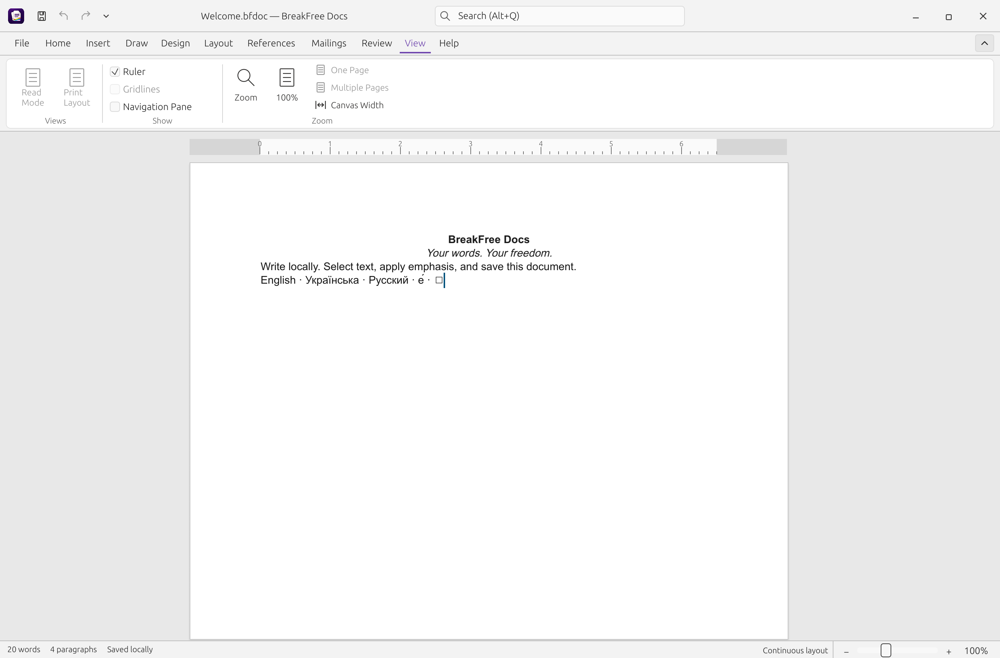

[QAT menu](screenshots/rust-qat-menu-alpha9-macos.png) ·
[QAT below the ribbon](screenshots/rust-qat-below-alpha9-macos.png) ·
[narrow Canvas Width](screenshots/rust-view-fit-alpha9-macos-narrow.png).

```sh
BREAKFREE_CAPTURE_TO="$PWD/docs/screenshots/view-review.png" \
  cargo run --locked --release --features capture --example capture_ui -- 1366 900 view
```

Other new capture modes: `view-fit`, `keytips-qat`, `keytips-qat-below` (the last
uses staged fixture key events to move the toolbar). Windows PowerShell uses
`$env:BREAKFREE_CAPTURE_TO` as in the existing capture instructions below.
These captures validate rendering; native keyboard evidence is recorded separately
in VALIDATION.md. No Word installation or matched Windows 100/125/150% comparison
was available. Intentional brand differences and the comparison gate below remain.

## Alpha.8 quick-access and tab KeyTips

Historical checkpoint; alpha.9 above supersedes fixed toolbar order and View geometry.

This extends alpha.7's input state machine without moving editing into the GUI.
The [official QAT keyboard guide](https://support.microsoft.com/en-us/accessibility/office-accessibility/use-a-keyboard-to-customize-the-quick-access-toolbar)
describes position-based numbers; numbers depend on toolbar order, not a universal
Word default. The [official Word navigation guide](https://support.microsoft.com/en-us/accessibility/word/use-a-screen-reader-to-explore-and-navigate-word)
documents Alt+W,K for navigation and Alt+W,Q for Zoom. Inspected 2026-10-17.
No controlled Word 2024 Windows instance is available. **JI Draw, Y1 Help and
W,R ruler are provisional Docs assignments** pending that comparison; do not
present them as verified mappings for a named Word 2024 build.

| Level | Implemented behavior |
| :--- | :--- |
| Quick Access Toolbar | Root 1 Save, 2 Undo, 3 Redo; also direct Alt+1/2/3. Fixed positions never renumber when history is empty. Unavailable actions show gray hints and do nothing; enabled actions use the same command/history/save path as the buttons |
| Tabs | H Home, N Insert, JI Draw, G Design, P Layout, S References, M Mailings, R Review, W View, Y1 Help. Multi-key prefixes filter hints and support Backspace. Direct Alt+first-key starts a sequence; later keys may retain Alt |
| Narrow tab overflow | Root T opens the actual More tabs menu; hidden rows show their tab codes at the right. T is Docs-specific. Direct hidden-tab sequences work without opening the menu. Escape closes this menu and returns to root; expanding the window past overflow returns to root without a stranded popup |
| Unimplemented tabs / Help | Retain their own scope, suppress invalid access-key text, explain unavailable commands or informational Help, and return to root with Escape. No action hints are invented for placeholder groups |
| View | K toggles Navigation Pane, R toggles canvas rulers, Q opens Zoom. Active toggle state is visible. Arrows/Tab hand off to the same enabled-control focus registry; Ctrl+Left/Right moves between Show and Zoom |
| Zoom | Modal 280-DIP content width, selected percent field, 75/100/150/200% presets, bounded whole-number 50–200% input, OK/Enter and Cancel/Escape. Invalid values retain the draft. Background shortcuts and window close cannot bypass it. Acceptance changes view scale only, with no document-history entry |

QAT badges use dedicated title anchors rather than File/other Save button bounds.
Existing badge geometry remains 17 DIP high, 12-DIP text; disabled badges use
#e0e0e0 with #7d7d7d text. View uses a 110-DIP Views column, 145-DIP Show buttons
and an 88-DIP Zoom button, with 30-DIP control heights inside the existing ribbon.
These are measured implementation dimensions, not reference-app measurements.
The continuous canvas, 50–200% zoom range and lack of pagination remain explicit.
Toolbar customization, contextual object commands and advanced tabs are not added.

### Alpha.8 native captures

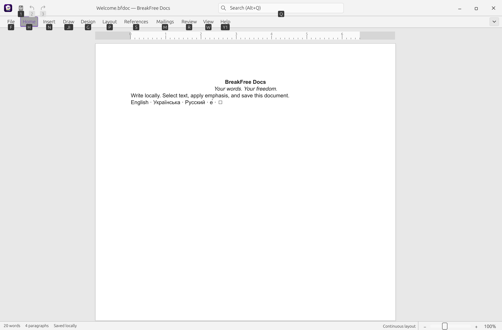

[View hints](screenshots/rust-keytips-view-alpha8-macos.png) ·
[More tabs at 640 × 480 DIP](screenshots/rust-keytips-tabs-alpha8-macos-narrow.png) ·
[Zoom at 640 × 480 DIP](screenshots/rust-zoom-alpha8-macos-narrow.png).

Captured and inspected on 2026-10-17: English/light, Welcome fixture, 100% document
zoom, backing scale 2; wide captures 1366 × 900 DIP. Root uses tabs-only mode.
The native capture fixture waits for both measurement frames and popup animation;
it injects deterministic events and does not prove OS key delivery. Native macOS
interaction is recorded separately in VALIDATION. The inherited missing emoji
glyph remains visible. Brand differences remain the original logo/name and violet
accents. Remaining reference differences include simplified View controls/Zoom,
fixed quick-access order, continuous canvas and unimplemented advanced tabs. No
matched Word 2024 Windows capture or similarity percentage is available.

## Alpha.7 KeyTips and Alt entry

The [official keyboard guide](https://support.microsoft.com/en-us/accessibility/word/keyboard-shortcuts-in-word),
[official Home KeyTips image](https://support.microsoft.com/en-us/accessibility/media/word-365-ribbon-keytips.png)
and [text-formatting guide](https://support.microsoft.com/en-gb/accessibility/word/use-a-screen-reader-to-insert-and-change-text-in-word)
were inspected on 2026-10-17. They support Alt/F10, Home entry, the emphasis,
size/Font and alignment routes. The image is labeled Word 365, not a controlled
Word 2024 screenshot. [File keyboard guidance](https://support.microsoft.com/en-us/accessibility/office-accessibility/keyboard-shortcuts-for-the-file-menu-in-microsoft-365-for-windows)
informs the File routes. Exact mappings and behavior under a named Word 2024 build,
especially Editing and paste submenus, remain subject to the Windows comparison.
No reference image is bundled as application artwork.

| Entry / level | Implemented sequence and effect |
| :--- | :--- |
| Bare Alt release / F10 | Show top-level hints; repeat to leave and restore prior focus. Alt used in a chord, with Shift/Ctrl/Command, or across focus loss does not arm bare-Alt entry |
| Top level | F File; H Home; Q search. N/G/P/S/M/R/W select Insert/Design/Layout/References/Mailings/Review/View and hand off to existing focus navigation; hidden-tab routes still work |
| Home Font | 1 Bold, 2 Italic, 3 Underline; FS editable size, FN Font dialog, FG/FK Grow/Shrink |
| Home Paragraph | AL/AC/AR/AJ left/center/right/justify |
| Home Clipboard | X Cut, C Copy; V opens Paste, T inserts plain text. Only enabled commands receive hints |
| Home Editing | FD Find, R Replace; SL opens Select, A selects all. SL remains a two-step menu route when Editing moves into More |
| Responsive More | E opens the actual overflow; FD/R/A/P select Find/Replace/Select All/Formatting. E and P here are Docs-specific assignments |
| File | N New, O Open, S Save, A Save As, T Options. These use Docs' existing local actions/settings, without additional reference-app pages or cloud services |
| Prefix / cancellation | Show matching full codes after a prefix; Backspace removes one letter, invalid input keeps it unchanged. Escape clears prefix, then menu → Home → top level → prior focus |
| Navigation / pointer | Tab/arrows/Enter/Space/F6 dismiss hints and continue existing navigation. Pointer press dismisses hints before normal click routing. Commands retain their usual focus destination |

Badges are **Docs design values**, not Word measurements: 17 DIP high, width
10 + 7 × code length, 12-DIP white text on #373737, 2-DIP corners. They are painted
on a noninteractive tooltip layer using real control rectangles. Main-control
centers sit 2 DIP below the lower edge; menu/File hints sit at the right of each
row. Prefix filtering does not change layout. Disabled features have no active
hint; Cut/Copy hints appear only with a selection. No imaginary command is added.

`gui::keytips` owns only presentation/input state. It dispatches the same Action
and menu handlers as pointer/focus navigation. Input processing preserves event
order, consumes access-key text partners and suppresses held-key repeats until
release. Size entry immediately resumes native text handling. IME events, active
composition and modal drafts block entry. Ctrl+Alt key events cannot be mistaken
for Ctrl-only commands; their committed text is retained (synthetic AltGr case).

Bare Alt observes egui modifier-state transitions; a very short tap coalesced
entirely between frames may be invisible to this adapter. F10 remains available.
The macOS automation tool rejects modifier-only presses, so bare Alt has event-test
evidence only. Native AltGr, layout switching, IME and Windows 100/125/150% still
need real-device acceptance. The alpha.8 section records subsequent quick-access,
tab and View coverage; no full reference-app keyboard equivalence is claimed.

### Alpha.7 native captures

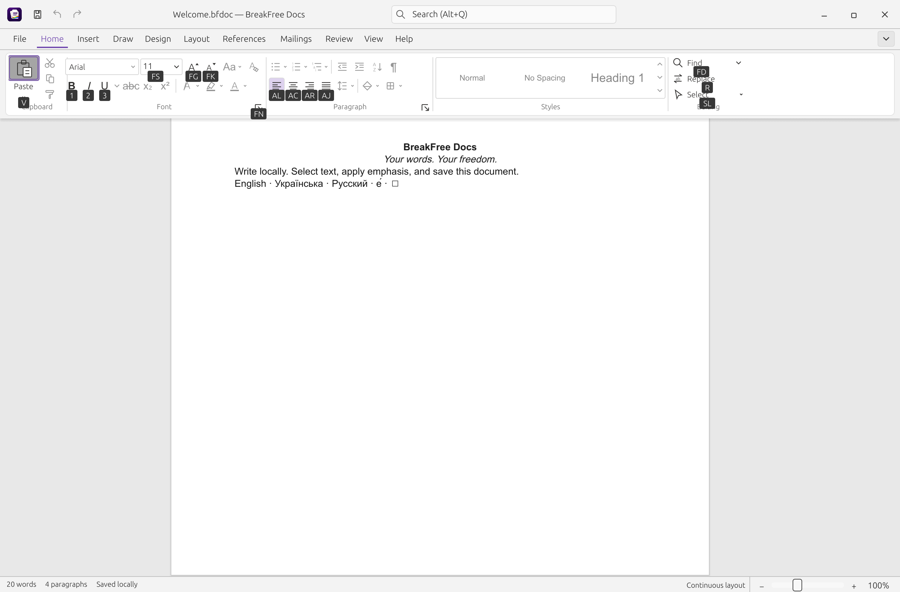

[Top-level hints](screenshots/rust-keytips-root-alpha7-macos.png) ·
[Prefix F](screenshots/rust-keytips-prefix-alpha7-macos.png) ·
[Home at 640 × 480 DIP](screenshots/rust-keytips-home-alpha7-macos-narrow.png).
Captured and inspected on 2026-10-17: English/light theme, Welcome fixture,
100% document zoom, backing scale 2. Wide views are 1366 × 900 DIP. The capture
harness injects deterministic focus/key events into the actual native renderer;
these pictures establish rendering, not OS key delivery. The separate native
interaction smoke is recorded in VALIDATION. The inherited missing emoji glyph
and continuous canvas remain visible. Brand differences remain the approved logo,
name and restrained violet accent; no reference branding is used. A matched Word
2024 Windows capture is unavailable, so no pixel deltas or similarity percentage
are supplied.

## Alpha.6 collapsed ribbon and Home keyboard behavior

The [official ribbon visibility guidance](https://support.microsoft.com/en-us/office/foundations-experiences/show-or-hide-the-ribbon-in-office)
and keyboard reference above were checked on 2026-10-17. They cover Word 2024 and
other Office versions; the implementation below remains a documented subset.

| Trigger | Implemented behavior |
| :--- | :--- |
| Ctrl+F1 / double-click tab / tab context menu | Switch pinned ribbon and tabs-only mode; close temporary expansion |
| Click a collapsed tab | Overlay the same 104-DIP ribbon directly below the 44+32-DIP title/tabs; retain the document's position and collapsed preference |
| F10 / Alt+H | Focus active tab / open Home and focus its first enabled control |
| Left/Right on tabs; Tab/Down/Enter/Space | Change the active tab; enter its commands (Home has full command routing) |
| Tab / Shift+Tab within Home | Traverse enabled controls in group order; return to the active tab at the ends; disabled features are skipped |
| Arrows / Ctrl+Left or Right | Move spatially within a Home group / focus the next or previous group containing enabled commands |
| Down / Alt+Down on a menu or size field | Open dropdown and focus its first enabled choice; arrows/Tab navigate, Enter/Space applies |
| Escape | Close a menu first; then close temporary ribbon and focus its tab; then return to document. In the size field, discard its draft and return directly to document |
| Command or click outside | Dismiss temporary expansion; preserve model selection for commands. Enter/blur commits size input; Escape cancels |
| F6 / Shift+F6 | Cycle document → visible navigation → visible formatting → status → ribbon, forwards/backwards; never open a hidden pane |
| Resize with Editing focused | Redirect focus to the visible More trigger when Editing moves to overflow |

The temporary ribbon uses the same group geometry and responsive breakpoints as
pinned Home, with a subtle 3-DIP-offset shadow. Its overlay intentionally covers
the canvas below the tabs until dismissed; it does not imply pagination. Focus
and open-menu state live in `src/ribbon_navigation.rs`, separate from document
commands. The native size input keeps cursor/selection/IME behavior. Live document
IME preedit blocks ribbon keyboard entry. Alpha.7 extends this focus router with
KeyTips below; native screen-reader traversal still requires review.

### Alpha.6 native captures

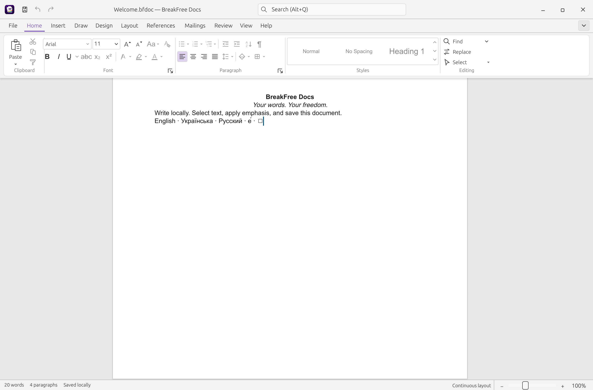

[Tabs-only, 1366 × 900 DIP](screenshots/rust-collapsed-alpha6-macos.png) ·
[Temporary Home, 640 × 480 DIP](screenshots/rust-temporary-alpha6-macos-narrow.png).
Captured and inspected on 2026-10-17, macOS, English/light theme, document zoom
100%, backing scale 2. The same Welcome fixture has unchanged canvas position
between collapsed and temporary captures. The narrow ribbon fits; More remains
visible. This fixture still exposes the existing missing emoji glyph/font-fallback
limitation. These are working program captures, not Word comparisons.

## Actual application capture (alpha.5 history)

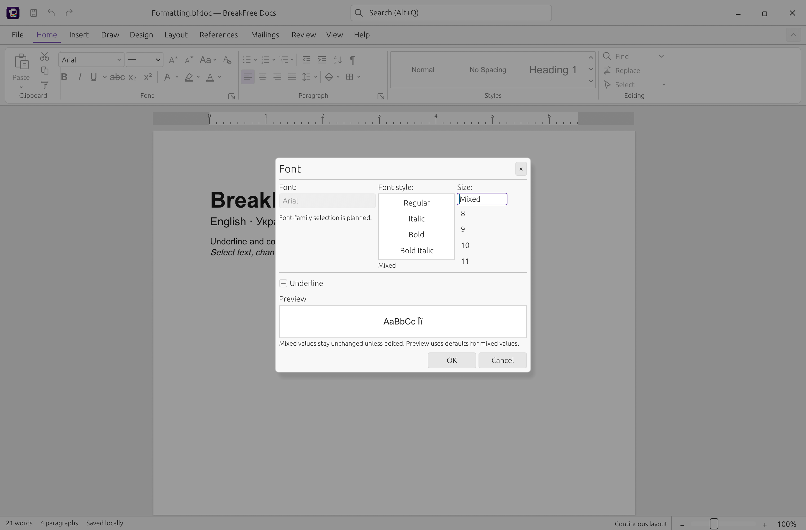

Alpha.5, captured 2026-10-16: [Home](screenshots/rust-home-alpha5-macos.png) and
Font dialog at 1366 × 900 DIP / 2732 × 1800 px; minimum-window
[Home](screenshots/rust-home-alpha5-narrow-macos.png) and
[Font](screenshots/rust-font-alpha5-narrow-macos.png) at 640 × 480 DIP / 1280 × 960 px.
All four native renders were inspected. Formatting fixture, English UI, light theme,
Arial, 100% document zoom and macOS backing scale 2. The Font capture selects the
whole fixture and reports mixed size/style/underline without editing it. Home's
caret rests at the final 11-pt italic run. No ribbon controls overlap; all modal
controls fit the minimum window. Find's primary target and its 18-DIP arrow are
separate; the 104-DIP ribbon geometry is otherwise retained from alpha.4.

The development capture helper now waits eight frames and requests an actual
native framebuffer screenshot, allowing modal measurement passes to finish. Its
previous two-pass capture omitted the initial modal; those incomplete images were
replaced. This does not change the production CLI. The native keyboard/save smoke
is recorded in [VALIDATION](VALIDATION.md). No matched Word/Windows capture exists.

Historical alpha.4 captures follow:

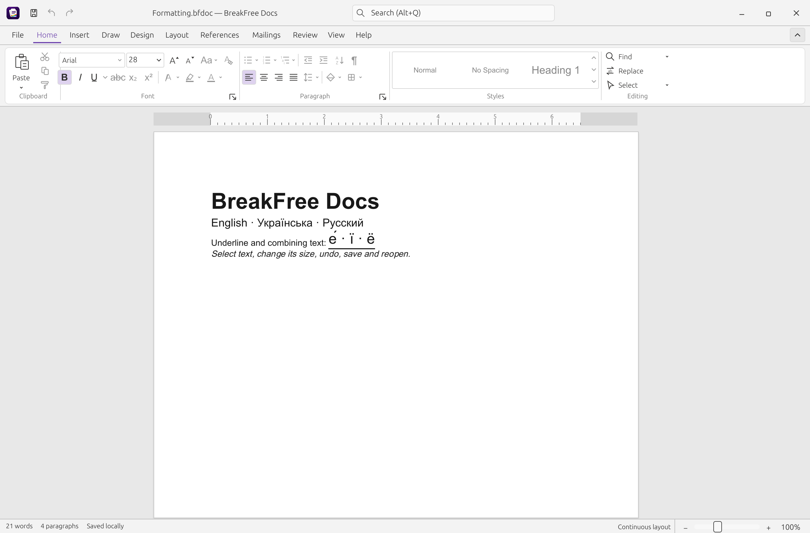

Alpha.4, captured 2026-10-16: same Formatting fixture, English UI, light theme,
Arial and 100% document zoom as alpha.3. Native client sizes/backing scale 2:
1366 × 900 DIP (2732 × 1800 px), [960 × 700](screenshots/rust-home-alpha4-compact-macos.png)
(1920 × 1400 px) and [640 × 700](screenshots/rust-home-alpha4-narrow-macos.png)
(1280 × 1400 px). All three renders were inspected. Menus, captions, size input
and font-step buttons remain within Home; narrow documents scroll horizontally.

| Measured Docs implementation change | Alpha.3 | Alpha.4 |
| :--- | :--- | :--- |
| Expanded ribbon height | 112 DIP | 104 DIP |
| Font/Paragraph row origin separation | 36 DIP | 29 DIP |
| Full Clipboard width | 156 DIP | 86 DIP; icon-only Cut/Copy/Format Painter |
| Font size control | Separate 50 + 17 DIP controls, 1-DIP gap | Unified 64-DIP outline |
| Style gallery | Separate AaBbCc cards and small labels | Inline names, one gallery border, stacked navigation |
| Minimum-width font stepping | Not implemented | Grow/Shrink visible at 640 DIP |

These compare Docs revisions, not measured Word deltas. The official theme image
was re-inspected in the browser; it supports the composition changes only.
Alpha.4 also passed a limited native macOS input/dialog smoke; see
[validation](VALIDATION.md). Windows/reference and native DPI checks remain open.

Historical alpha.3 captures follow:

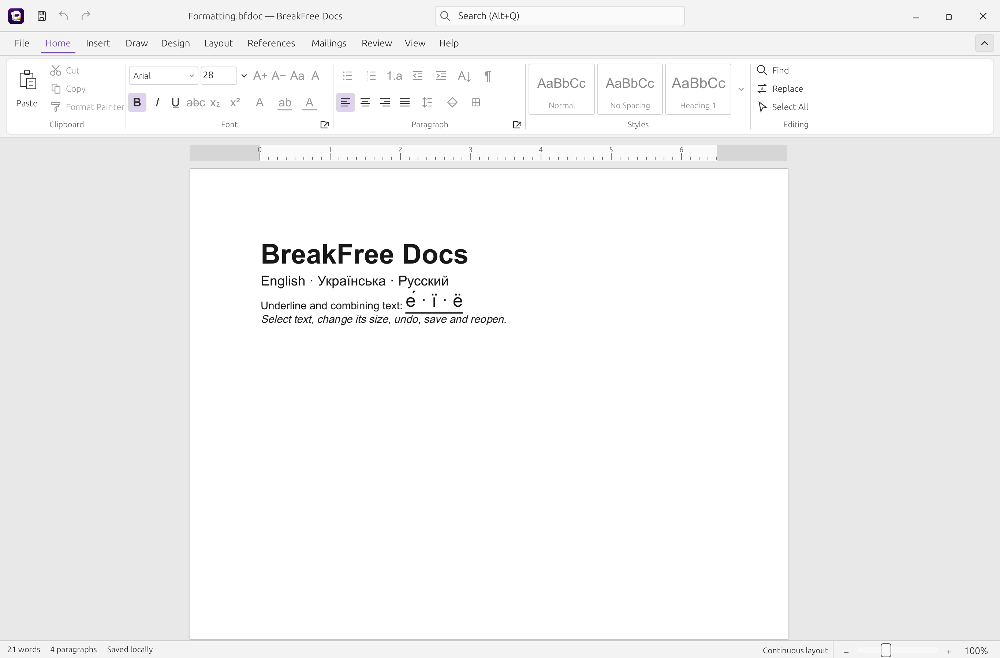

Alpha.3, captured 2026-10-16: actual native rendering of
[Formatting.bfdoc](../examples/Formatting.bfdoc), English UI, light theme, 100%
document zoom, Arial, 1366 × 900 DIP / 2732 × 1800 physical pixels (backing scale 2).
The model contains four paragraphs and 21 Unicode words. The first run is bold
28 pt; the Home field reports 28 at its caret. Subsequent runs use 14, 11 and
18.5 pt, including underlined `é · ї · ё`. The same fixture was inspected at
[720 × 700 DIP / 1440 × 1400 physical pixels](screenshots/rust-formatting-narrow-macos.png).
Home retains size/underline controls without overlap; the continuous canvas scrolls
horizontally at this width. No pagination or native Windows result is implied.

The following captures retain the earlier alpha.1 shell checkpoint (before active
size/underline controls), rather than representing the current formatting scope:

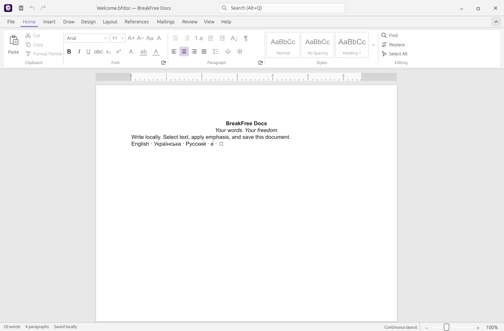

Captured from the running native Rust executable using eframe's opt-in screenshot
feature, with `examples/Welcome.bfdoc`, Home expanded, navigation hidden, English UI,
light theme, document zoom 100%. Client size is 1366 × 900 DIP / 2732 × 1800 physical
pixels (macOS backing scale 2), host Arial body font. This is actual model content:
20 Unicode words, four paragraphs, saved state and center alignment on the first
paragraph. It is not a Windows capture or a paired Word comparison. The emoji at
the end renders as a missing glyph on this host; its scalar content survives edits
and native saves. No complete emoji/complex-script rendering support is claimed.

Additional native renders from the same harness:

- [720 × 700 DIP Home / overflow](screenshots/rust-home-narrow-macos.png), same saved fixture, backing scale 2.
- [1366 × 900 DIP File](screenshots/rust-file-macos.png), a real new empty document: zero words, one paragraph, zero characters; no fabricated recent files.
- [Earlier Home capture](screenshots/rust-home-macos.png) is retained as the previous implementation checkpoint.

The capture helper uses the same `DocsApp`, controls and layout as the editor.
To reproduce fixed-size captures (a native desktop session is required):

```sh
BREAKFREE_CAPTURE_TO="$PWD/artifacts/home.png" cargo run --locked --features capture --example capture_ui -- 1366 900 home
BREAKFREE_CAPTURE_TO="$PWD/artifacts/narrow.png" cargo run --locked --features capture --example capture_ui -- 720 700 home
BREAKFREE_CAPTURE_TO="$PWD/artifacts/file.png" cargo run --locked --features capture --example capture_ui -- 1366 900 file
BREAKFREE_CAPTURE_TO="$PWD/artifacts/formatting.png" cargo run --locked --features capture --example capture_ui -- 1366 900 formatting
BREAKFREE_CAPTURE_TO="$PWD/artifacts/formatting-compact.png" cargo run --locked --features capture --example capture_ui -- 960 700 formatting
BREAKFREE_CAPTURE_TO="$PWD/artifacts/formatting-narrow.png" cargo run --locked --features capture --example capture_ui -- 640 700 formatting
BREAKFREE_CAPTURE_TO="$PWD/artifacts/font.png" cargo run --locked --features capture --example capture_ui -- 1366 900 font
BREAKFREE_CAPTURE_TO="$PWD/artifacts/font-narrow.png" cargo run --locked --features capture --example capture_ui -- 640 480 font
```

Create `artifacts` first. On Windows PowerShell, set `$env:BREAKFREE_CAPTURE_TO`
to the absolute PNG path and run the same Cargo arguments. `navigation` is also
accepted in place of `home`. This development example adds no production CLI flags.

## Alpha.18 paragraph styles

Normal, No Spacing and Heading 1 are actual paragraph styles. The full gallery
retains its 63-DIP frame and name previews (12-DIP body / 18-DIP bold heading).
Compact mode shows the current uniform style, or an unselected Normal card for
mixed paragraphs; the 15 × 61-DIP trailing More styles button opens the complete
catalog. Minimum width uses Home More. Group widths, 8-DIP gutters, light palette
and original icons remain unchanged. No redundant disabled scrolling arrows are
shown for a three-item catalog. Modify style is disabled with an explanation.

Apply changes whole intersected paragraphs in one undo; text, direct font overrides
and alignment remain. A selected name denotes paragraph identity even if direct
formatting changes its appearance. Clear character formatting removes overrides
and reveals each paragraph's inherited properties. The default 11-pt Normal,
bold 18-pt Heading 1 and true single-spaced/no-gap No Spacing are defined in
[ADR 0006](adr/0006-built-in-paragraph-styles.md), with explicit migration limits.
The canvas remains continuous, and a heading does not imply outline navigation
or pagination. There is no hover preview or automatic following-style transition.

Cards and menus register with existing Tab/arrows/Enter navigation. F10/Alt → H →
L opens the gallery menu; N/S/H selects Normal/No Spacing/Heading 1. At minimum width
H → E opens More with the same N/S/H routes. These are provisional Docs mappings;
exact Word 2024 KeyTip parity is unverified. Escape cancels, and an applied style
returns to the document/collapses the temporary ribbon. Command search exposes the
same names. IME composition and modal drafts block style application.

Reference: Microsoft's [Styles gallery documentation](https://support.microsoft.com/en-us/word/add-and-remove-styles-from-the-quick-styles-gallery).
This supports the Home grouping; no matched Windows capture or similarity score
is claimed. Native macOS captures and checks are recorded separately below and in
[validation](VALIDATION.md#alpha18-style-inheritance-validation).

### Alpha.18 native captures

macOS arm64, light UI, 100% document zoom, backing scale 2. Inspected 2026-10-17.
The source is [Styles.bfdoc](../examples/Styles.bfdoc); the caret is in its final
Normal paragraph. Heading/body size and real zero-gap pairs come from the model.
The menu capture uses F10/H/E, exposing styles at the 640 × 480 minimum size.
No matched Word/Windows image is available; these are scoped Docs visual checks.

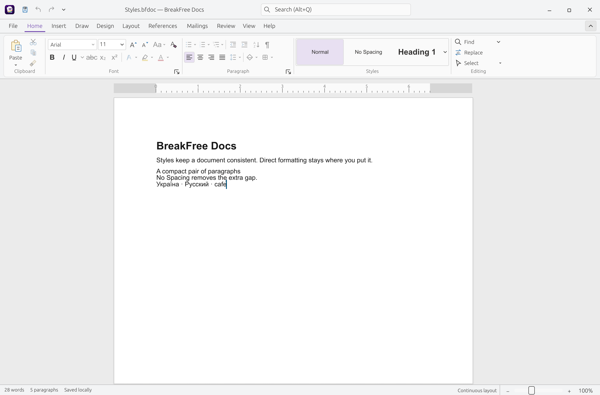
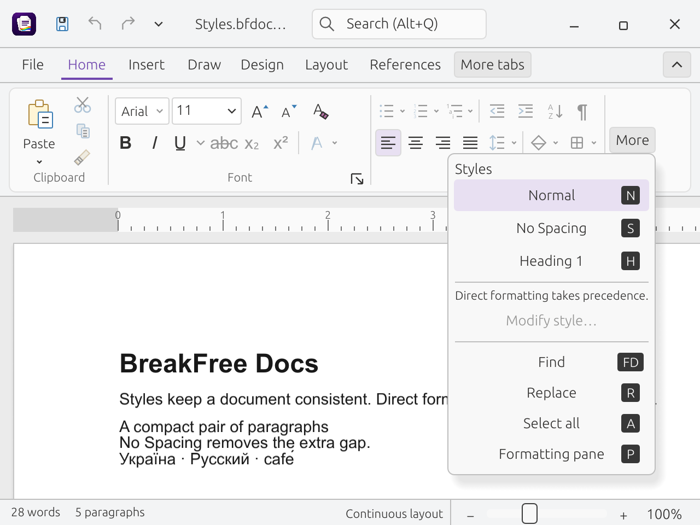

Reproduce with `cargo build --locked --release --features capture --example capture_ui`:

```sh
BREAKFREE_CAPTURE_TO="$PWD/docs/screenshots/rust-styles-alpha18-macos.png" target/release/examples/capture_ui 1366 900 styles
BREAKFREE_CAPTURE_TO="$PWD/docs/screenshots/rust-styles-alpha18-macos-narrow.png" target/release/examples/capture_ui 640 480 styles-menu
```

## Intentional brand differences

- BreakFree Docs title and approved transparent page/rainbow icon.
- Violet selection/active-tab accents with light neutral chrome; rainbow only in the logo.
- No Microsoft account/sign-in, autosave toggle, sharing or service buttons.
- Honest continuous-layout and save-state labels instead of invented page counts.

## Remaining differences and reproducible comparison gate

Current gaps include print pagination and page rulers, vertical ruler, font-family/color controls, lists/character styles, contextual object tabs, KeyTips for future commands,
view-mode buttons, additional File operations and complete native window/accessibility
behavior. Metrics are provisional until measured against the named reference.

For the next review, record Windows edition/build, Word 2024 edition/build, Docs
commit, GPU/font setup, English UI and Light/White theme. Use the same physical
client size (first 1366 × 900, then 1920 × 1080), document zoom 100%, same Unicode
fixture text and installed Arial. Capture each application separately at Windows
100%, 125% and 150%. Record resulting DIP sizes, title/tab/ribbon/status heights,
control bounds, group gaps and clipped labels. Check wide and overflow layouts,
pointer selection, Ctrl shortcuts, Shift navigation, IME commit/cancel, file pickers
and unsaved dialogs. Attach paired images and a delta table; do not invent a score.

Local widget tests exercise synthetic scales 1/1.25/1.5 at 960/1366/1920 physical
widths, verify group bounds and nonoverlap with workspace/status, and collapsed
ribbon. Added 27 width/scale cases at 640/720/899/900/916/1195/1196/1366/1920 DIP and
1/1.25/1.5 verify each Home control stays in its group, controls do not overlap, and
title/search/window controls remain separate. A separate test exaggerates UI font
metrics to prevent the Windows 125% launcher-height regression. Pointer tests cover disabled commands,
selection across formatting/history, new font-step buttons/shortcuts, Paste/Find/
Select menus, Escape cancellation, narrow overflow, zoom/reset and File navigation/
dirty New. All supported font sizes are tested for bounded step behavior. These
are CPU layout tests, not native Windows scaling or visual validation.

The capture helper also accepts `keytips-root`, `keytips-home`, `keytips-prefix`,
`keytips-tabs`, `keytips-view` and `keytips-zoom`:

```sh
BREAKFREE_CAPTURE_TO="$PWD/docs/screenshots/keytips-review.png" \
  cargo run --locked --release --features capture --example capture_ui -- 1366 900 keytips-home
```

These modes inject fixture focus/key events; they do not validate native Alt input.

## Alpha.19 Modify Style

The existing Home gallery and its palette/icons/gutters are preserved. A card's
context menu opens Modify Style for that card without applying it. More styles /
minimum-width More and command search edit the first selected paragraph's style.
Provisional KeyTips: F10 or Alt, H → L → M; minimum width H → E → M.
These are tested Docs mappings, not a claim of exact Word shortcut parity.

The light modal has a 460-DIP content width (about 474 DIP including frame), a
fixed style name, Based on, three tri-state emphasis selectors, size, percentage
line spacing and point spacing-after fields. Grid gaps are 14 × 7 DIP, numeric
fields 290 DIP, character preview 448 × 48 DIP and action buttons 82 × 27 DIP.
The initial size is selected for replacement. Blank fields inherit; a cycle/range
error disables OK. The preview clips oversized fonts; it does not simulate
paragraph spacing. Gallery previews use actual resolved emphasis/size, bounded to
12–20 DIP within unchanged cards. Dialog selection closes its dropdown; Escape
first closes a dropdown, then cancels the draft. Enter applies a valid draft.

Only OK submits one shared Modify Style command. Cancel/Escape preserve history;
background edits, file shortcuts and window close wait for the draft. The document
has the same text/direct formatting, but inherits changed definitions immediately.
The [official Modify Style workflow](https://support.microsoft.com/en-us/word/customize-or-create-new-styles)
was checked on 2026-10-18. Supported properties and current-document scope are
intentional restrictions; custom IDs, font family/color, templates, following
style and automatic update remain absent. Alignment stays paragraph-owned.

### Alpha.19 native captures

Actual macOS captures at 1366 × 900 and 640 × 480 DIP, 2× backing scale, English
light UI and 100% canvas zoom. The window and controls fit without overlap or
clipped labels in these captures; inherited character previews use the real font.

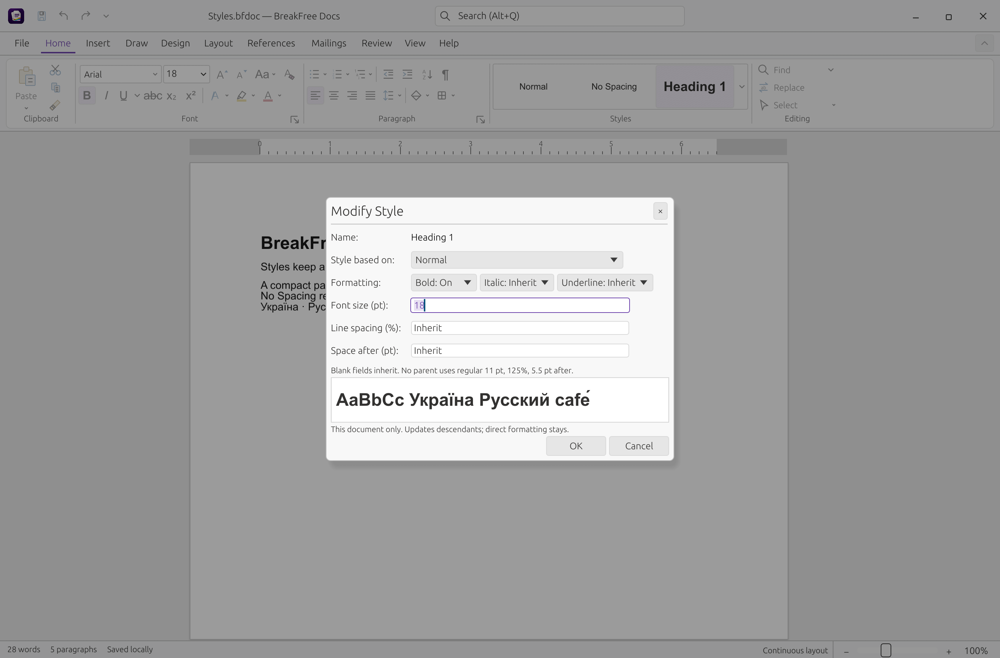
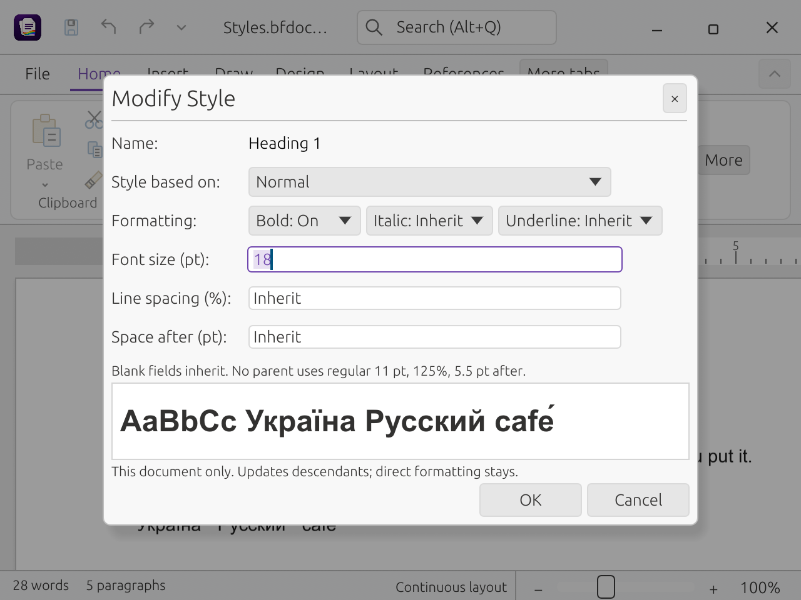

Reproduce with the existing `capture` feature example and mode `styles-modify`.
Native macOS interaction and synthetic 1/1.25/1.5 geometry are documented in
[validation](VALIDATION.md#alpha19-editable-style-validation). Word 2024 Windows,
matched reference captures, native Windows DPI and physical IME were unavailable;
no visual equivalence percentage is inferred. Brand differences remain the Docs
logo/title, violet selection accents and restrained original multicolor icons.

## Alpha.20 Create Style

Home Styles/More → Create style and command search now open a local Create Style
draft. Provisional KeyTips are H → L → C at wide/compact widths or H → E → C at
minimum width. Name receives initial focus and retains focus after invalid Enter.
Choose a built-in/custom parent or No style, supported properties and whether to
apply to the selected paragraphs (initially checked). Creation/application share
one undo; Cancel/Escape leaves the model intact. Names and parent graphs validate
before OK is enabled. Custom definitions also use Modify Style.

| Component | Implemented bounds/behavior |
| :--- | :--- |
| Draft | 460-DIP content width, two-column grid, 14 × 7-DIP gaps, 290-DIP name/numeric fields and parent selector; stays inside 640 × 480 at synthetic 1/1.25/1.5 scales |
| Parent choices | Scrollable, 150-DIP maximum list height; target excluded during Modify; names truncate without expanding the window |
| Preview/actions | Existing 448 × 48-DIP character preview, 82 × 27-DIP OK/Cancel; spacing remains a property, not a simulated paragraph preview |
| Styles menu | 220-DIP content width; 210 × 27-DIP rows inside a 150-DIP maximum scroll area; directional navigation scrolls the focused entry into view |
| Gallery | Selected custom style replaces the third wide card or the sole compact card; bounded 12–20-DIP preview, end ellipsis for long names, full-name tooltip/AX label |
| Limits | Up to 64 custom styles; creation disables at the limit with a visible explanation. Duplicate names use Unicode lowercasing, not canonical normalization |

The [official styles guide](https://support.microsoft.com/en-us/word/customize-or-create-new-styles)
was checked on 2026-10-18. It supports the named gallery workflow, but does not
establish matched measurements. This draft starts from an explicit parent instead
of copying direct formatting from selected text; mini-toolbar, templates, character
styles, rename/delete and following-style transitions are deferred. Existing light
palette, violet accents, original colored icons, logo and 8-DIP Home gutters stay.
There is no claim of exact Windows keyboard or visual parity.

### Alpha.20 native captures

Final alpha.20 capture binary, macOS arm64, light theme, English UI, 100% document
zoom; backing scale 2. Captures use the synthetic [v5 example](../examples/CustomStyles.bfdoc).
Inspected both: no unintended dialog/control overlap; long gallery names end with
an ellipsis; the narrow dialog's buttons remain inside the window. Native Word 2024
Windows is unavailable here, so matched reference captures and Windows 100/125/150%
verification remain unperformed. Historical captures retain their versions.

```sh
cargo build --locked --release --features capture --example capture_ui
BREAKFREE_CAPTURE_TO="$PWD/docs/screenshots/rust-create-style-alpha20-macos.png" target/release/examples/capture_ui 1366 900 styles-create
BREAKFREE_CAPTURE_TO="$PWD/docs/screenshots/rust-create-style-alpha20-macos-narrow.png" target/release/examples/capture_ui 640 480 styles-create
```

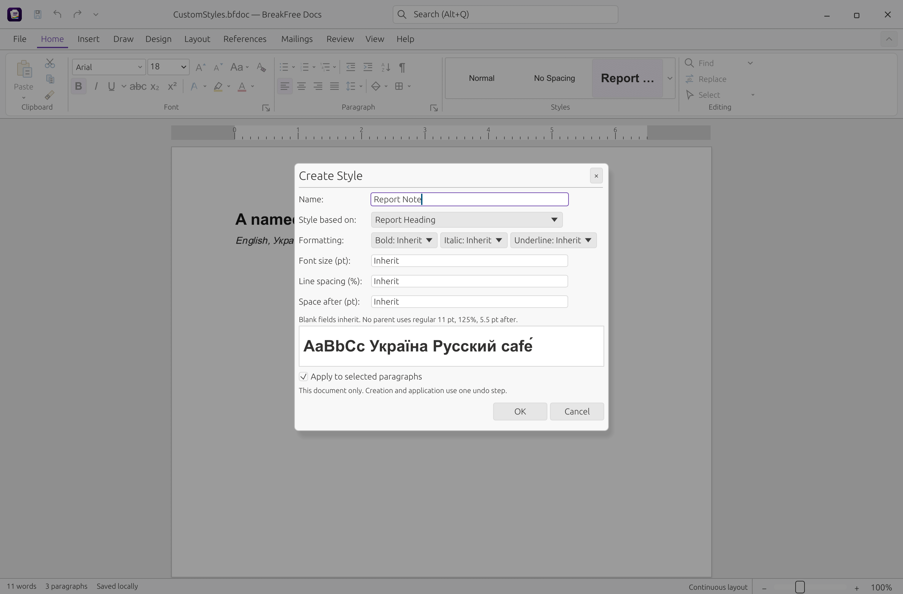
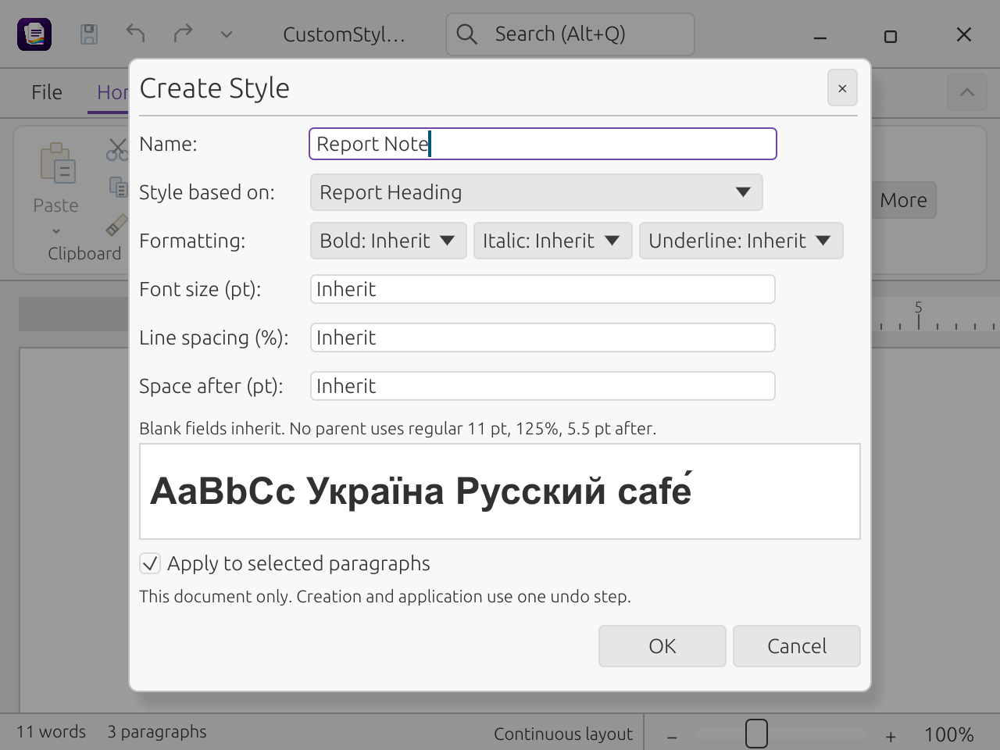

## Alpha.21 custom-style renaming

Modify Style now selects an editable Name when targeting a custom style. Built-in
names remain fixed. Enter or OK validates the name, parent and properties together;
Cancel/Escape preserves the document and redo branch. Invalid Enter retains name
focus, with a visible error and disabled OK. A name-only change updates labels,
tooltips, search and parent choices without reflowing document text.

The existing 460-DIP content width, 290-DIP name field, 14 × 7 grid gaps,
448 × 48 preview and 82 × 27 actions remain. All dialog/control bounds fit the
minimum window at synthetic 1/1.25/1.5 scale. Right-click a gallery card or any
Styles-list row → Modify style targets that ID without applying it to text; the
context popup remains available after the source menu closes. Keyboard entry for
the selected style remains H → L → M or narrow H → E → M via F10/Alt KeyTips.

No redesign of palette, icons, gallery spacing, logo or continuous canvas. Exact
Word keyboard/visual equivalence, Windows DPI, templates, character styles and
style deletion remain unverified or unimplemented as previously documented.

### Alpha.21 native captures

Inspected the final alpha.21 capture executable on macOS arm64, light theme,
English UI, 100% document zoom and backing scale 2. Both 1366 × 900 and 640 × 480
DIP captures show a draft rename of the synthetic v5 example; controls and actions
remain in bounds without unintended overlap. The original applied style still
appears behind the uncommitted draft, as expected. These are native renders with
synthetic input, separate from the [native interaction check](VALIDATION.md#alpha21-rename-validation).
Matched Word 2024 Windows captures and native Windows 100/125/150% are unavailable;
no similarity percentage or full platform acceptance is claimed.

```sh
cargo build --locked --release --features capture --example capture_ui
BREAKFREE_CAPTURE_TO="$PWD/docs/screenshots/rust-rename-style-alpha21-macos.png" target/release/examples/capture_ui 1366 900 styles-rename
BREAKFREE_CAPTURE_TO="$PWD/docs/screenshots/rust-rename-style-alpha21-macos-narrow.png" target/release/examples/capture_ui 640 480 styles-rename
```

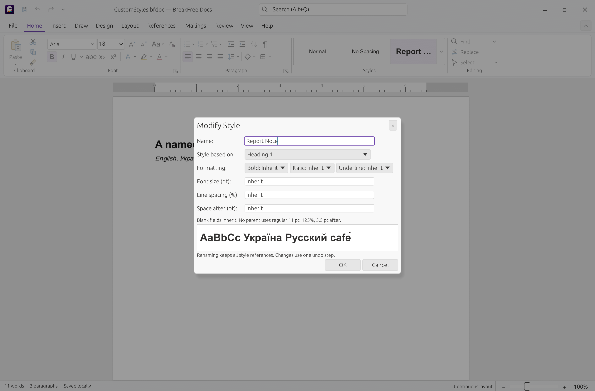
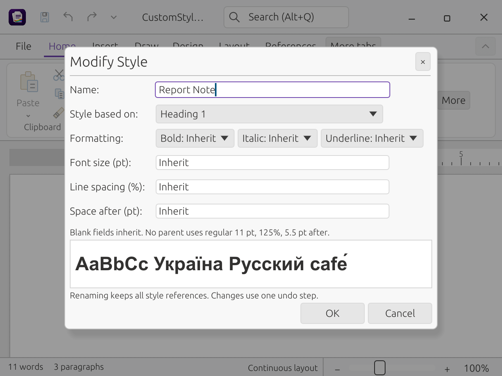

## Alpha.22 Delete Style

Home Styles/More → Delete style, command search and provisional H → L → D or
narrow H → E → D KeyTips open a modal for the first selected paragraph's style.
A gallery/list context menu can target an unused or unselected custom definition
without applying it. Built-in targets are disabled with an explanation.

| Component | Implemented bounds/behavior |
| :--- | :--- |
| Dialog | 460-DIP content width; target name truncates with full tooltip; actual directly affected paragraph and child-definition counts |
| Replacements | Two 280-DIP selectors in a two-column grid with 14 × 10 gaps. Lists have 150-DIP maximum height and exclude the target. Child parent additionally offers No style |
| Validation | Whole surviving graph checked, including built-in children and indirect cycles. Invalid selections show an error and disable Delete |
| Actions/focus | 82 × 27 Delete/Cancel. Cancel starts focused; Enter activates the focused control. Escape dismisses a selector before the draft. Tab reaches Delete; confirmation commits one undo |
| Model effect | Paragraphs and immediate child parents use independent choices. Indirect parent links, text, alignment and direct formatting stay. Inherited appearance may change, as the visible note explains |

This is an explicit Docs reference-replacement policy, not a claim that Word uses
this exact deletion dialog. The light palette, violet accents, original colored
icons, logo and Home gutters stay unchanged. Single replacement for all direct
children is intentional; per-child remapping, templates, character/following
styles, pagination and complete native reference parity remain outside scope.

### Alpha.22 native captures

Final alpha.22 capture executable, macOS arm64, light theme, English UI, 100%
document zoom, backing scale 2. The synthetic [deletion example](../examples/StyleDeletion.bfdoc)
contains a parent, child and indirect descendant. Both inspected native renders
fit the name, counts, choices, explanation and actions inside 1366 × 900 and
640 × 480 DIP windows without unintended overlap. The background document remains
unchanged while the draft is open. These capture inputs are synthetic; actual
keyboard/pointer/Save/reopen checks are separate in [validation](VALIDATION.md#alpha22-deletion-validation).

```sh
cargo build --locked --release --features capture --example capture_ui
BREAKFREE_CAPTURE_TO="$PWD/docs/screenshots/rust-delete-style-alpha22-macos.png" target/release/examples/capture_ui 1366 900 styles-delete
BREAKFREE_CAPTURE_TO="$PWD/docs/screenshots/rust-delete-style-alpha22-macos-narrow.png" target/release/examples/capture_ui 640 480 styles-delete
```

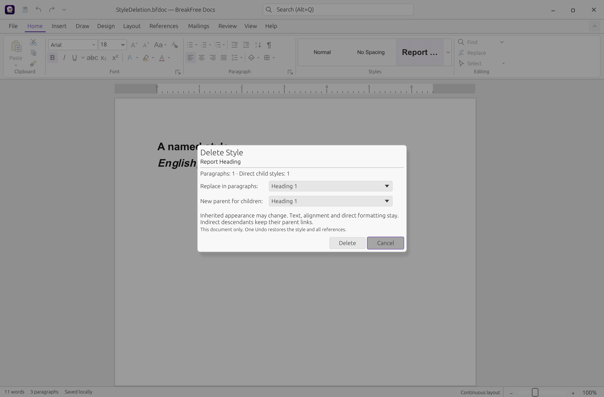
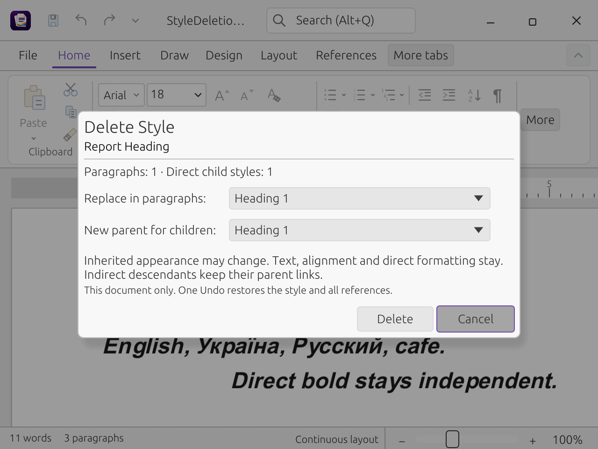

Native Windows 100/125/150%, physical IME/AltGr, screen-reader acceptance and matched
Word 2024 Windows captures remain unavailable. No similarity percentage is claimed.

## Alpha.23 following paragraph styles

Create/Modify Style adds Following paragraph immediately after Based on. The
existing 460-DIP content width, 290-DIP selector, 150-DIP popup cap and 14 × 7-DIP
property-grid gaps are retained. Same style is the explicit default, independent
of inheritance. All built-in/custom names appear in a bounded menu; long labels
truncate. The document stays unchanged until OK. Palette, original icons, preview,
keyboard/modal guards and Home gutters remain unchanged.

Delete Style additionally counts following references and explains their remapping
to the chosen paragraph replacement. These controls perform real shared commands.
No new tab or decorative action is introduced. See
[ADR 0010](adr/0010-following-paragraph-styles.md) for Enter and migration policy.

### Alpha.23 native captures

macOS arm64, English/light, 100% document zoom, backing scale 2; 1366 × 900 and
640 × 480 DIP. Both inspected: the added row, formatting controls and buttons stay
inside the modal and viewport. No matched Word/Windows comparison or percentage
similarity is claimed. Native Windows 100/125/150%, physical IME and accessibility
remain separate gates. Existing synthetic scale tests include the enlarged dialog.

```sh
BREAKFREE_CAPTURE_TO="$PWD/docs/screenshots/rust-following-style-alpha23-macos.png" target/release/examples/capture_ui 1366 900 styles-following
BREAKFREE_CAPTURE_TO="$PWD/docs/screenshots/rust-following-style-alpha23-macos-narrow.png" target/release/examples/capture_ui 640 480 styles-following
```

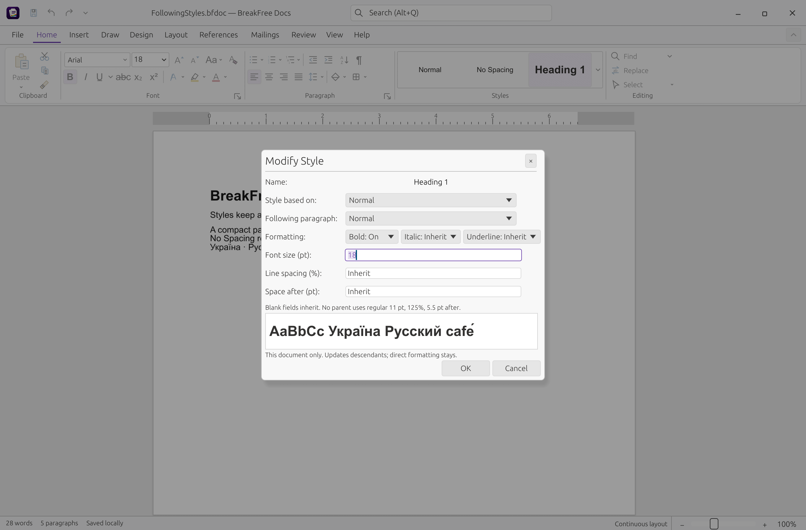
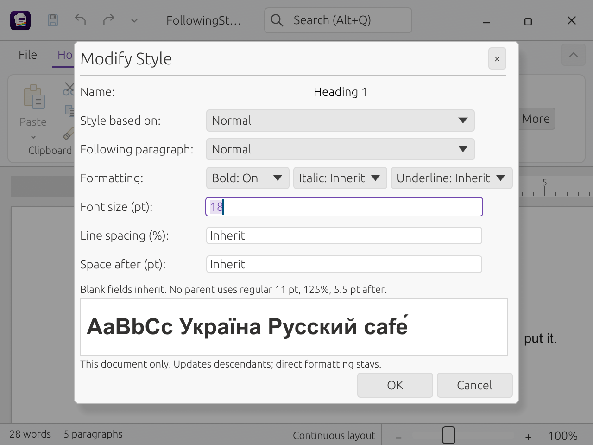

## Alpha.24 native captures

Home Styles now includes a Character styles section inside the existing 220-DIP
menu / 150-DIP scroll viewport, with 210 × 27-DIP rows: Default paragraph font,
Strong and Emphasis. The latter two preview bold/italic. Paragraph gallery cards
remain unchanged. Direct formatting still wins; tooltips distinguish clearing
properties from removing the named character style. Arrow keys scroll hidden rows;
clipped rows cannot paint KeyTips over other commands. B/I/Z are Docs access keys
within Styles (narrow Editing overflow); exact Word parity is not claimed.

The existing palette, original icons, 8-DIP gutters and light continuous canvas are
unchanged. Captured on macOS, backing scale 2, English, light theme, 100% document
zoom. These are real native renders, not matched Windows reference comparisons.

| Capture | Viewport | SHA-256 |
| --- | --- | --- |
| [Character styles fixture](screenshots/rust-character-styles-alpha24-macos.png) | 1366 × 900 DIP | `1d23a2a64df82834f49b014d2ebb16aad84bb486669130c68a1083f1e4414692` |
| [Narrow Styles menu](screenshots/rust-character-menu-alpha24-macos-narrow.png) | 640 × 480 DIP | `df57fa50645f90af14bd30a8a30ea3d80cd7c88ce7058dc621912fc2ec9550d1` |

The narrow initial scroll position shows paragraph styles and Default paragraph
font; Strong/Emphasis are reached by scrolling/arrow keys or their access keys.
The Latin/Cyrillic/combining fixture renders as inspected; emoji fallback shows a
missing glyph on this machine although the stored scalar survives. No full script
coverage claim, pagination claim or numeric similarity score is made. Windows
100/125/150%, physical IME and matched Word 2024 Windows captures remain open.

Reproduce with `cargo build --locked --release --features capture --example capture_ui`,
then `BREAKFREE_CAPTURE_TO=/absolute/output.png target/release/examples/capture_ui
1366 900 styles-character` (or `640 480 styles-menu`). The harness is a developer
utility, not an integration command.

## Alpha.25 native captures

Create Character Style reuses the 460-DIP style-draft content width, 290-DIP name
and size fields, existing three property combos and clipped 448 × 48-DIP preview.
Paragraph-only parent/following/spacing controls are absent. Apply to selection /
future typing, OK and Cancel retain the existing visual language. Home's 150-DIP
scroll list contains custom names and Create character style; K enters creation
inside Styles or narrow Editing KeyTips. Direct overrides are explicitly preserved.

Native macOS, English/light theme, 100% zoom, backing scale 2; not paired with a
Windows reference. Text and controls fit the inspected minimum-size dialog.

| Capture | Viewport | SHA-256 |
| --- | --- | --- |
| [Creation draft](screenshots/rust-named-character-alpha25-macos.png) | 1366 × 900 DIP | `05dbd215518b7a8eeb9d0bbafaf426449a8aaf231110a02f1f0a315ce08ff395` |
| [Minimum-window draft](screenshots/rust-named-character-alpha25-macos-narrow.png) | 640 × 480 DIP | `4cf81aca92eb3d5c5b25d480452249a94bea0654cc04c6b691f987d49c5838d7` |

Reproduce using the existing capture build and mode `styles-character-create`.
`styles-character-custom` opens the v8 NamedCharacterStyles fixture. Brand differences
and Windows/Word/DPI/physical IME limitations remain as documented above; no numeric
similarity claim. Keyboard Tab was used for native text-field focus verification.

## Alpha.26 native captures

Modify Character Style retains the shared neutral draft, purple focus ring and
original ribbon icons. Read-only name preserves identity; three 90-DIP tri-state
controls, 290-DIP size input, 448 × 48-DIP clipped preview and 82 × 27-DIP buttons
fit both inspected windows. Initial keyboard focus selects size; Enter applies,
Escape cancels. Home Styles/command search and J KeyTip target a uniform custom
style; its list-row context command also edits unused definitions.

Captured on macOS at backing scale 2, light theme, English, 100% document zoom:

| Capture | Window | SHA-256 |
| --- | --- | --- |
| [Modify draft](screenshots/rust-modify-character-alpha26-macos.png) | 1366 × 900 DIP | `065ed1cd40876805370cfa0f30887f68a2e04b065593b6ba03bde6bad44a40ff` |
| [Modify draft](screenshots/rust-modify-character-alpha26-macos-narrow.png) | 640 × 480 DIP | `a0d02ad0c0f51911a5e2fd6a6703cbdef9745ffe3f92935cd93ca689524a484b` |

No overlap or clipped action labels observed. Native KeyTips/size/Enter/Save,
one Undo/Redo and fresh-process reopen passed. Brand differences remain the
BreakFree identity, purple focus and original icons. Windows/Word side-by-side
captures, native 100/125/150% DPI, physical IME and full accessibility were not
available. Synthetic scaling is separate evidence; no similarity percentage.

## Alpha.27 native captures

Modify Character Style now focuses and selects its editable 290-DIP name field.
Name and properties share OK/Cancel and one transaction. Existing dimensions,
neutral surfaces, purple focus, preview clipping and original icons are unchanged.
Light theme, English, 100% document zoom, macOS backing scale 2:

| Capture | Window | SHA-256 |
| --- | --- | --- |
| [Rename draft](screenshots/rust-rename-character-alpha27-macos.png) | 1366 × 900 DIP | `c5e90335fdb94b78578694692fc254caab024cad6c958f592a3e422db31cd619` |
| [Rename draft](screenshots/rust-rename-character-alpha27-macos-narrow.png) | 640 × 480 DIP | `e21601fc86d8b1c243b240170e251300054d19347f4b1f1b3ae174597410db16` |

Both inspected captures keep labels/actions within the window. Native Unicode rename/history/save/reopen passed. Matched Windows/Word screenshots and native DPI/IME acceptance remain unavailable; no similarity percentage is claimed.

## Alpha.28 native captures

Delete Character Style uses the existing neutral modal and purple keyboard focus.
The draft has a 440-DIP replacement selector, real reference-scalar count,
wrapped explanation and 82 × 27-DIP actions. Cancel starts focused; Tab then Enter
activates Delete. Replacement options exclude the target and include removal,
Strong, Emphasis and surviving custom styles. X opens this draft in Styles/Editing
KeyTips; the custom-row context menu supports unused definitions.

Light theme, English, 100% document zoom, macOS backing scale 2:

| Capture | Window | SHA-256 |
| --- | --- | --- |
| [Deletion draft](screenshots/rust-delete-character-alpha28-macos.png) | 1366 × 900 DIP | `ca022069d3a4ae04de34d3e7cfae4121a90b2d0eb90c86e0853aac34d4a46e78` |
| [Deletion draft](screenshots/rust-delete-character-alpha28-macos-narrow.png) | 640 × 480 DIP | `80948fcc7e20395b4a193dd27a4cd2ee6eec81e69468af280ff3ad629d06b4f2` |

Both inspected captures fit controls and labels without overlap. Native replacement/keyboard deletion/history/save passed. Windows/Word comparison and native DPI/IME acceptance remain open. Palette, original icons and branding are retained; no similarity percentage is claimed.

## Alpha.29 native captures

Create/Modify Character Style adds a 290-DIP **Style based on** selector,
with paragraph fallback, built-in and custom parents. Invalid graphs disable OK
and show a validation error. Preview uses the same cascade as document rendering.
Neutral surfaces, purple focus, original icons and other modal dimensions remain.
Light theme, English, 100% document zoom, macOS backing scale 2:

| Capture | Window | SHA-256 |
| --- | --- | --- |
| [Parent draft](screenshots/rust-character-parent-alpha29-macos.png) | 1366 × 900 DIP | `eb9f70dce99bb9d81778c2da2c771709c8591514345692c076e0fdceecbbfdd6` |
| [Parent draft](screenshots/rust-character-parent-alpha29-macos-narrow.png) | 640 × 480 DIP | `09b917d1f2f4658d1a30beafad69d9ec1086edbd82a6f57eb21693c719a768b3` |

Both captures were inspected: controls and labels fit without overlap. Native parent selection, Save, one Undo/Redo and fresh-process reopen passed. Matched Word/Windows captures and native 100/125/150% DPI remain unavailable. No similarity percentage is claimed.

## Alpha.30 formatting provenance

The existing right Formatting pane retains 220-DIP default width (195–300 range).
Its body now scrolls vertically, leaving the heading/close control fixed. Each
supported character property has a resolved-value row followed by a wrapping
source label. Names use the current document catalog; mixed values/sources are
independent. The selection count and future-typing label describe real state.
Neutral surfaces, purple focus and original icons are unchanged.

Light theme, English, 100% document zoom, macOS backing scale 2:

| Capture | Window | SHA-256 |
| --- | --- | --- |
| [Formatting](screenshots/rust-provenance-alpha30-macos.png) | 1366 × 900 DIP | `314adc93d5aeb74d172adcd135874ba801ad9eb61a1c47ea8d3eadf7fe07fb83` |
| [Formatting](screenshots/rust-provenance-alpha30-macos-narrow.png) | 640 × 480 DIP | `3e2f0a9560224bfa31764587308db4e2eef23cb99b2507c32cb5500a5365e0b4` |

Both captures inspected; no new overlap observed. Narrow body scrolls to lower commands. Native selection/direct-format/Undo/Redo source updates verified. Windows/Word comparison and native DPI remain unavailable; no similarity percentage claimed.

## Alpha.31 paragraph provenance

Formatting adds a Current paragraph / Selected paragraphs section after character
properties. Alignment, Line spacing (%) and Space after (pt) each have value and
wrapping source rows. The existing 220-DIP pane width and scrollable body remain;
heading/close stay fixed. No palette, icon or ribbon geometry change.

Light theme, English, 100% document zoom, macOS backing scale 2:

| Capture | Window | SHA-256 |
| --- | --- | --- |
| [Paragraph sources](screenshots/rust-paragraph-provenance-alpha31-macos.png) | 1366 × 900 DIP | `6d7fc16318fa9da5c706434295d97097e121c99ad6cd03578bd501702ffd2704` |
| [Paragraph sources](screenshots/rust-paragraph-provenance-alpha31-macos-narrow.png) | 640 × 480 DIP | `be9ac73737db870e6aaae9e04ee6df79cddc168e43c6f0a157c414e8e0adff46` |

Both captures inspected; rows do not overlap. Lower rows and commands require scrolling at minimum height. Native No Spacing/centering/Undo/Redo source updates passed. No matched Windows/Word comparison or native Windows DPI verification; no similarity percentage claimed.

## Alpha.32 style filtering

The 220-DIP Styles menu adds a 210-DIP name field and a scope/Reset row above the
existing 150-DIP scrollable list. Scope cycles All, Paragraph, Character, Custom;
its tooltip explains the order. Management commands remain available when no style
matches. F3 focuses the field; Down enters results; Enter applies and Escape closes.
Filter state survives popup reopening within the session, not application restart.
Neutral surfaces, purple focus and original icons are retained.

Light theme, English, 100% document zoom, macOS backing scale 2:

| Capture | Window | SHA-256 |
| --- | --- | --- |
| [Filtered styles](screenshots/rust-style-filter-alpha32-macos.png) | 1366 × 900 DIP | `f552895d5c09c06a81fc7df3eb1d8d07ae2c2f9eb2061b760e3d122f47f503b2` |
| [Filtered styles](screenshots/rust-style-filter-alpha32-macos-narrow.png) | 640 × 480 DIP | `29a6e3a5e0607e4e75eb201f312e24ccf179ae951e8d9576620408eb7ed8241d` |

Both captures inspected; controls fit, with the compact overflow popup moved upward by the toolkit. Native keyboard/filter/reset/category checks passed. Windows/Word side-by-side and native DPI remain unavailable; no similarity percentage is claimed.

## Alpha.33 used styles

The Styles menu adds a Used in document checkbox below scope/Reset. It intersects
name and category filters, retaining assigned paragraph/character styles and all
parents. Reset clears all three filters. The scrollable list is now 125 DIP high
to keep lower management commands inside the minimum-height popup. Palette and
icons are unchanged. Partial bottom rows are reached by scrolling.

Light theme, English, 100% document zoom, macOS backing scale 2:

| Capture | Window | SHA-256 |
| --- | --- | --- |
| [Used styles](screenshots/rust-used-styles-alpha33-macos.png) | 1366 × 900 DIP | `25242693c3c88630eb9ed47d14429249bd8daee0b1f715fe69b87e2029f97098` |
| [Used styles](screenshots/rust-used-styles-alpha33-macos-narrow.png) | 640 × 480 DIP | `c1d8a830a445d319bea2232c9e9c84ad4ba779700b2949b3588aaab0e0266b20` |

Both harness captures inspected: checkbox and commands fit; narrow popup relocates upward. Ordinary native menu acceptance remains incomplete after automation lost its window. No matched Word/Windows DPI comparison was available.

## Alpha.34 style usage captions

Each style command retains its 210 × 27 DIP button and existing action ID. A
secondary small-text line immediately below says Direct use, Parent dependency
or Not used. The tooltip explains direct-plus-parent precedence. Labels use the
existing text palette, not new color or icon meanings. The 125-DIP scroll area
and management controls stay bounded; fewer complete entries fit at once.
Name matching, keyboard targets and context commands still use style IDs/names.

Light theme, English, 100% document zoom, macOS backing scale 2. The fixture is
an empty Heading 1 paragraph: Normal is a parent dependency, Heading 1 is direct.

| Capture | Window | SHA-256 |
| --- | --- | --- |
| [Usage captions](screenshots/rust-style-usage-alpha34-macos.png) | 1366 × 900 DIP | `a572ae57d24a2f2512412607e2a79719bee6e90aaddcf6e6cf551d0fc32188e9` |
| [Usage captions](screenshots/rust-style-usage-alpha34-macos-narrow.png) | 640 × 480 DIP | `0e860f2d7c19dce2b0a1a9f72679acf831edb886d622465535269c07ae5447c9` |

Both native harness captures inspected: captions do not overlap and the compact popup stays inside the window. Partially visible bottom rows require scrolling. Normal native input was not repeated; matched Word/Windows DPI validation remains unavailable.

## Alpha.35 dependency consumers

Below the usage caption, a wrapping small-text Required by line lists unique
directly assigned descendants, including transitive ones. It is visible without
hover, uses the existing text palette and remains inside the 125-DIP scroll area.
Style buttons remain 210 × 27 DIP; long consumer lists require vertical scrolling.
This line is information only; navigation by consumer name is not implemented.

Light theme, English, 100% document zoom, macOS backing scale 2:

| Capture | Window | SHA-256 |
| --- | --- | --- |
| [Dependency consumers](screenshots/rust-style-consumers-alpha35-macos.png) | 1366 × 900 DIP | `8b3119c732d090b697dcf28e09ec42adc5aa46da03b21abb20f514ec0903a7f7` |
| [Dependency consumers](screenshots/rust-style-consumers-alpha35-macos-narrow.png) | 640 × 480 DIP | `49afa6ea85d1af19cffdc2414afda39b8d30a2ee9aa90d3bd1dea6a8d1983ba8` |

Both harness captures inspected: Normal shows Required by: Heading 1, with no overlap. Compact popup remains in bounds; lower rows require scrolling. Native keyboard input and matched Word/Windows DPI validation were not performed in this iteration.

## Alpha.36 dependency navigation

Required by names are separate wrapping, small-text, frameless buttons using the
existing palette. Hover/focus provide button feedback; the tooltip explains that
navigation clears name/category filters without applying formatting. Links join
the menu's directional keyboard targets. Activation focuses and scrolls to the
210 × 27 DIP style command, preserving the 125-DIP list viewport and used-only
setting. Returning to the original filter/parent view is not implemented.

Light theme, English, 100% document zoom, macOS backing scale 2:

| Capture | Window | SHA-256 |
| --- | --- | --- |
| [Dependency navigation](screenshots/rust-style-navigation-alpha36-macos.png) | 1366 × 900 DIP | `d6ee9482be19f7e29f32a13148fbc9541db3b36d3def9fdbc03e71149348f806` |
| [Dependency navigation](screenshots/rust-style-navigation-alpha36-macos-narrow.png) | 640 × 480 DIP | `2401d023765b5ecda2004a5d372355faf877159070cdce5afc35ac74ec08261d` |

Both harness captures inspected: names and commands do not overlap; lower rows require scrolling. Pointer/Enter focus handoff is covered by CPU widget events. Ordinary native input and matched Windows/Word/DPI validation were not repeated.

## Alpha.37 return navigation

Back to parent appears after the first dependency jump, outside the scrolling
list and below the filters. It uses the existing button/text palette and participates
in menu keyboard navigation. The list is 100 DIP high while Back is present,
otherwise 125 DIP. Return restores the first source and all three filters, then
focuses/scrolls to its row. Later jumps retain the same origin. Popup closure
discards it. No new icon, color role or document state is introduced.

Light theme, English, 100% document zoom, macOS backing scale 2; captured after
following Normal → Heading 1:

| Capture | Window | SHA-256 |
| --- | --- | --- |
| [Return navigation](screenshots/rust-style-return-alpha37-macos.png) | 1366 × 900 DIP | `3a96fca973269aed85e1472f4e3c2d926009b4a7bdc41002d1f077b074983967` |
| [Return navigation](screenshots/rust-style-return-alpha37-macos-narrow.png) | 640 × 480 DIP | `306eba75d3360be16cf619a4bdd8c3a014198139ccfc5b80702400e7c577daba` |

Both harness captures inspected: Back and the focused destination fit without overlap. Other rows require scrolling. Pointer/Space return is covered by CPU widget events; ordinary native keyboard and matched Windows/Word/DPI verification were not performed.

## Alpha.38 named return

The return button shows Back to: <original parent name>, resolved from its stable
ID each frame. A 210-DIP minimum expands to the existing 220-DIP menu width; height
is 23 DIP. Long labels truncate without expanding the popup; the tooltip includes
the full name. The existing palette, icons and 100-DIP return-mode list remain.

Light theme, English, 100% document zoom, macOS backing scale 2:

| Capture | Window | SHA-256 |
| --- | --- | --- |
| [Named return](screenshots/rust-named-return-alpha38-macos.png) | 1366 × 900 DIP | `7fb4940a028eaa6dac4272b214c869708942ad9b095e8578ef124184ba85947e` |
| [Named return](screenshots/rust-named-return-alpha38-macos-narrow.png) | 640 × 480 DIP | `e552d4db849e5212dbf81afdeaeb9a0625b5b7a2beca6fa974d63e7e300f74e6` |

Both harness captures inspected: Back to: Normal fits without overlap. Long Unicode-name width and live rename are checked by widget tests. Ordinary native input and matched Windows/Word/DPI verification were not performed.


## Alpha.39 dependency navigation

An unavailable return row leaves the exact saved filters intact, displays a
wrapped explanation inside the existing scrolling list and focuses the name
filter. Explicit filter changes dismiss the notice and cancel pending jumps.
Palette, icons, menu width and list height remain unchanged.

Light theme, English, 100% document zoom; macOS backing scale 2. Captures show
Normal → Heading 1 and the retained return control, not the unavailable notice.

| Capture | Window | SHA-256 |
| --- | --- | --- |
| [Dependency navigation](screenshots/rust-style-navigation-alpha39-macos.png) | 1366 × 900 DIP | `7fb4940a028eaa6dac4272b214c869708942ad9b095e8578ef124184ba85947e` |
| [Dependency navigation](screenshots/rust-style-navigation-alpha39-macos-narrow.png) | 640 × 480 DIP | `e552d4db849e5212dbf81afdeaeb9a0625b5b7a2beca6fa974d63e7e300f74e6` |

Both captures inspected. Windows/reference/DPI and ordinary native keyboard acceptance remain open; widget tests are separate evidence.


## Alpha.40 Windows acceptance preparation

No visual/runtime changes or new native screenshots. The 18-case widget matrix
covers 640 × 480, 1024 × 768 and 1366 × 900 DIP at synthetic 1.0/1.25/1.5 scales
with expanded/collapsed Home, keyboard traversal and Back bounds. It does not
exercise Windows display settings or physical input. Native Windows acceptance
was unavailable and remains open under [the checklist](WINDOWS_ACCEPTANCE.md).
Existing palette and original icons are unchanged.
