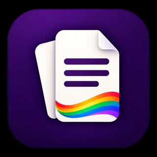

# BreakFree Docs icon

This is the owner-approved Docs design: portrait document pages, text lines and a rainbow ribbon on an aubergine app tile. It is distinct from the general Office, Sheets and Slides marks.

The current `breakfree-docs.webp` and `breakfree-docs-transparent.webp` are
byte-identical **256 × 256 WebP files with an alpha channel**, supplied by the
[upstream branding update](https://github.com/PerchAnton/breakfree-docs/commit/02fe5f4936b5ad505b7778d38502a1c742c0ace9).
They supersede the previous 320 × 320 opaque display derivative. The installed
prototype packages the current `breakfree-docs.webp` unchanged. These are display
assets, not vector masters or a complete operating-system icon bundle. Keep the
original high-resolution artwork for future packaging; do not upscale a display asset.

See the [shared brand guide](https://github.com/PerchAnton/breakfree-office/blob/main/BRAND.md). Asset licensing remains an owner decision.
